<div align="center">

# OCI Core

**Self-hosted multi-account management panel for Oracle Cloud Infrastructure (OCI)**

Consolidate compute, networking, storage, billing, and audit resources across multiple OCI tenancies and regions into a single lightweight console.

[](https://github.com/jsongmax/oci-core/releases)
[](https://github.com/jsongmax/oci-core/actions/workflows/ci.yml)
[](LICENSE)
[](https://go.dev)
[](https://vuejs.org)
[](#docker-deployment-recommended)

**[Live Demo →](https://jsongmax.github.io/oci-core/)** (Powered by built-in simulated data; no real Oracle account is connected)

[简体中文](README.md) · English

</div>

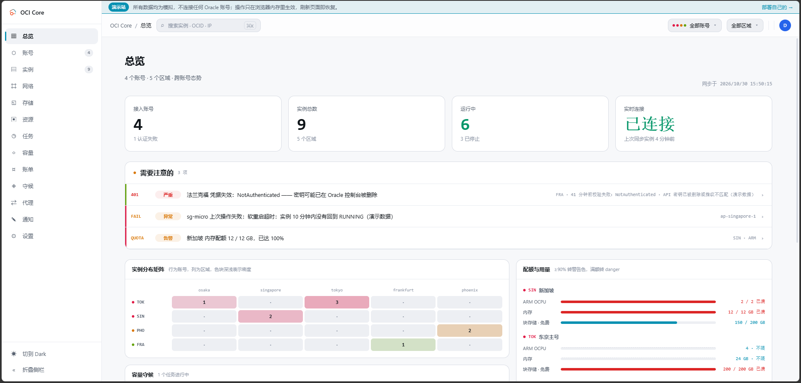

---

## Contents

- [Overview](#overview)
- [Features](#features)
- [Screenshots](#screenshots)
- [Deployment](#deployment)
  - [Docker Deployment (Recommended)](#docker-deployment-recommended)
  - [Prebuilt Binaries](#prebuilt-binaries)
  - [Deployment Notes](#deployment-notes)
- [OCI API Key & Least-Privilege IAM Setup](#oci-api-key--least-privilege-iam-setup)
- [Configuration](#configuration)
- [Security](#security)
- [Architecture & Tech Stack](#architecture--tech-stack)
- [Local Development](#local-development)
- [Known Limitations](#known-limitations)
- [Disclaimer](#disclaimer)
- [License](#license)

---

## Overview

OCI Core is a lightweight, single-binary, self-hosted web control panel designed for centrally managing infrastructure across multiple Oracle Cloud Infrastructure (OCI) accounts.

- **Single-binary delivery**: Frontend assets are embedded directly into the Go executable via `go:embed`, supporting statically linked binaries and multi-architecture container images with zero external runtime dependencies.
- **Minimal OCI client**: Implements draft-cavage HTTP Signature (RSA-SHA256) directly without the official OCI SDK, keeping the dependency tree minimal with deterministic retries and error classification.
- **Local-first storage**: Backed by pure-Go SQLite (`modernc.org/sqlite`) and a local master encryption key. All data and credentials remain on your host with zero third-party telemetry.

> **Currently out of scope**: Invoices and payment history from Oracle Account Center (no OCI-signed public API is available) and multi-user web RBAC.

---

## Features

### Accounts & Compute
- **Multi-tenancy onboarding**: Paste-and-parse OCI `config` files, per-check connectivity validation, account tier detection (trial / upgraded), account age and quota inspection, scheduled credential re-verification, encrypted key custody, and key rotation.
- **Permission self-check**: Combines IAM policy analysis with live read-only API probes on onboarding or on demand to evaluate every feature (`Available` / `Missing` / `Undetermined`) and generates copy-ready remediation policy statements.
- **Cross-account instance management**: Aggregated multi-account, multi-region view (SQLite-cached with real-time SSE state updates), customizable column visibility and ordering, lifecycle actions (start / stop / reset / terminate), online reshaping (including burstable OCPU), renaming, notes, bulk actions, OS-inferred SSH usernames, and a launch wizard supporting both free-tier presets and all shapes offered in the selected availability domain.
- **Background job queue**: Long-running tasks (instance launches, IP changes, reshapes, VNIC updates, storage operations, and bulk actions) run asynchronously with live step-by-step progress, retained failure diagnostics, and per-instance serialization.

### Networking & Storage
- **Virtual Cloud Networks**: Visual editor for VCNs, subnets, and security lists (with rule templates and automated network provisioning), grouped by account.
- **Multi-IPv4 & reserved public IPs**: Manage secondary private IPv4 addresses on primary and secondary VNICs; assign, replace, switch (ephemeral ↔ reserved), losslessly unbind, or release public IPs per private IP slot; centralized reserved IP pool and batch public IP replacement with optimistic concurrency checks.
- **IPv6 & secondary VNICs**: Add or remove multiple IPv6 addresses on any VNIC (displaying creation timestamps) and dynamically attach or detach secondary VNICs.
- **Block storage & rescue mode**: Resize boot and block volumes, adjust VPUs, attach/detach volumes, and generate OS-specific disk rescan and partition expansion commands; includes a guided **boot-volume rescue workflow** (detach broken boot volume → attach to helper instance → repair → reattach).

### Monitoring, Inventory, Billing & Capacity
- **Metrics & traffic**: Adaptive time-series charts for CPU, memory, and bidirectional network throughput, plus month-to-date inbound/outbound traffic from VCN VNIC metrics (no Cloud Agent required).
- **Resource inventory & cleanup**: Per-account summary of volumes, public/reserved IPs, console connections, and VCNs across regions compared against service limits and Always Free reference allowances, highlighting orphaned volumes, unassigned reserved IPs, leftover console connections, and VCNs without an internet gateway for direct cleanup.
- **Billing & usage analytics**: Aggregates current/previous month spend, daily trends, and breakdowns by service, region, and SKU via the OCI Usage API; tracks outbound data transfer against the 10 TB monthly free allowance and switches to consumption metrics (OCPU hours / GB months) for free-tier accounts.
- **Capacity monitor & hunter**: Polls Oracle's official **read-only** capacity report API for shape availability changes with notifications; Capacity Hunter schedules automated launch attempts with read-only capacity pre-checks enabled by default to avoid unnecessary launch calls.

### Security & Auditing
- **Authentication & hardening**: Argon2id password hashing, RFC 6238 TOTP two-factor authentication (QR enrollment and password-manager autofill support), session revocation, custom-header CSRF protection, login rate limiting, three-tier dangerous-action confirmations, and server-side TOTP re-verification.
- **Dual audit logging**: Provides both a **local panel audit log** (cursor pagination, full CSV export, optional retention policy) and **OCI cloud audit logs (Audit)** (query by account, subscribed region with Home Region indicator, nested compartments, and time window; supports cursor pagination, keyword/write/error filters, sensitive header redaction, privacy-mode JSON masking, and a 365-day retention notice).
- **Privacy mode**: Masks emails, public IPs, OCIDs, and fingerprints by default with per-field temporary reveal and a one-click top-bar toggle; copying always yields the unmasked value.
- **Identity domain password policy**: Reads and updates tenancy identity domain password expiration settings with post-write verification.

### Operations & Usability
- **Remote console**: Generates serial console and VNC tunnel connection strings (accepts user public keys only; never stores private keys).
- **Dedicated proxy pool**: Batch-import proxies in four common formats, test liveness and latency, and enforce strict 1:1 proxy-to-account egress binding (used from the very first connectivity check).
- **Notifications & i18n**: Supports Telegram, WeCom, DingTalk, Email, and Webhook channels with a per-event subscription matrix; full Simplified Chinese and English UI/API localization with an independent notification language setting.

---

## Screenshots

All screenshots are captured from the [live demo](https://jsongmax.github.io/oci-core/) using simulated data. Click any image for full resolution, and expand the sections below to browse additional views.

<details open>
<summary><b>Instances & Jobs</b> · List · Launch Wizard · Instance Details · Background Jobs</summary>
<br>

<table>
<tr>
  <td width="50%" valign="top"><a href="docs/screenshots/instances.png">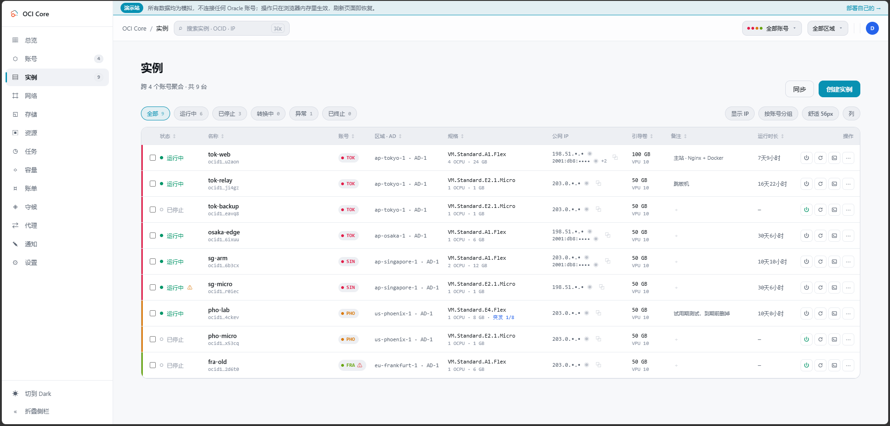</a><br><b>Instance list</b> · Cross-account view with color bars and short codes, customizable columns, and one-click public IP reveal</td>
  <td width="50%" valign="top"><a href="docs/screenshots/create-instance.png">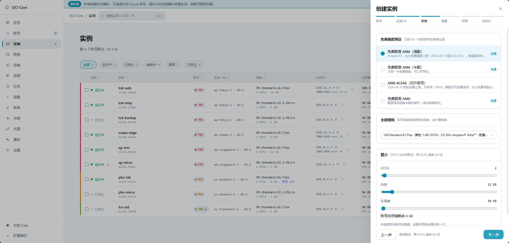</a><br><b>Launch wizard</b> · Free-tier presets alongside all shapes available in the target AD, with architecture-filtered images</td>
</tr>
<tr>
  <td width="50%" valign="top"><a href="docs/screenshots/instance-network.png">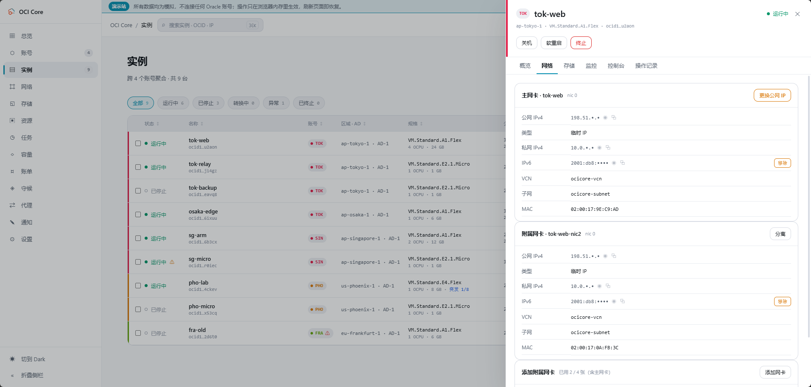</a><br><b>Instance networking</b> · Manage primary/secondary VNICs, multi-IPv4 slots, reserved/ephemeral public IPs, and IPv6 addresses</td>
  <td width="50%" valign="top"><a href="docs/screenshots/instance-storage.png">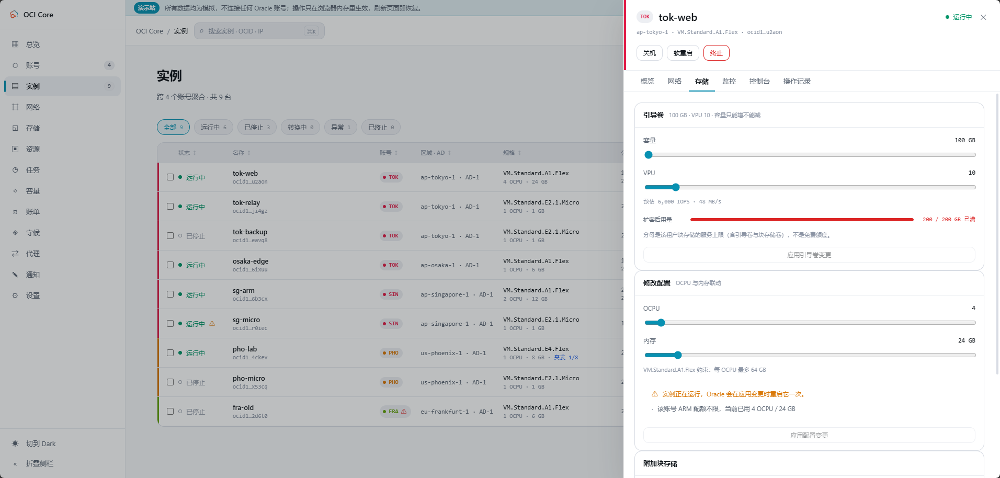</a><br><b>Storage & reshape</b> · Slider controls for boot volume size and VPUs, with linked OCPU/memory reshaping</td>
</tr>
<tr>
  <td width="50%" valign="top"><a href="docs/screenshots/instance-rescue.png">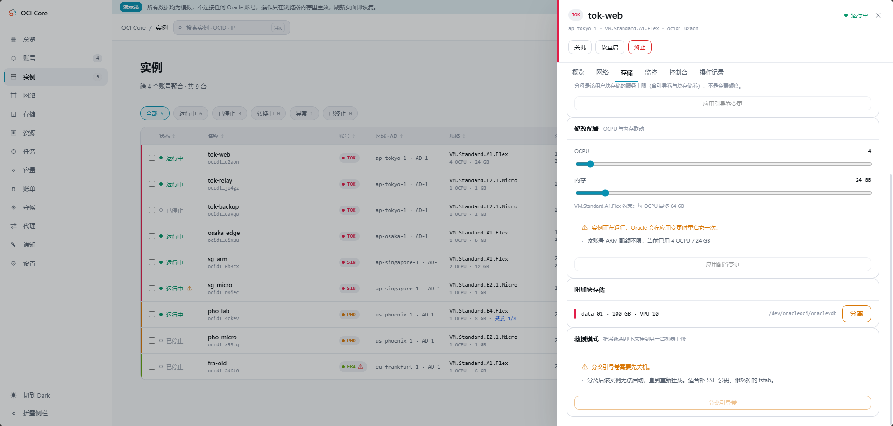</a><br><b>Rescue mode</b> · Guided workflow to detach a broken boot volume, mount it on a helper instance, and reattach it</td>
  <td width="50%" valign="top"><a href="docs/screenshots/instance-metrics.png">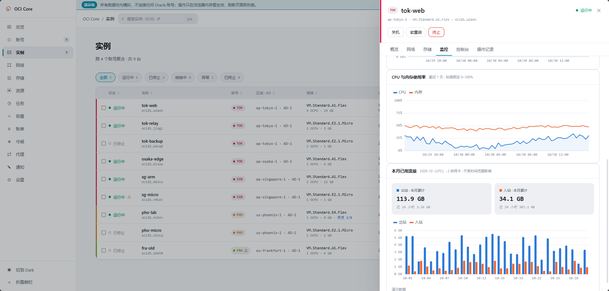</a><br><b>Metrics</b> · Adaptive CPU/memory charts and month-to-date inbound/outbound traffic statistics</td>
</tr>
<tr>
  <td width="50%" valign="top"><a href="docs/screenshots/instance-console.png">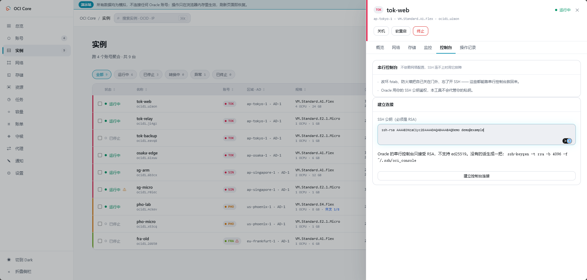</a><br><b>Serial console</b> · Out-of-band troubleshooting when SSH is unavailable; RSA public keys only</td>
  <td width="50%" valign="top"><a href="docs/screenshots/jobs.png">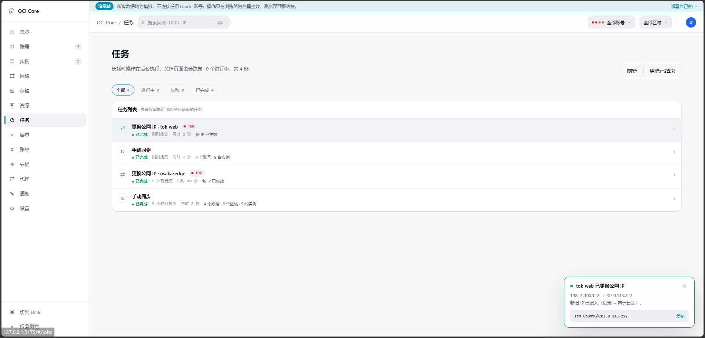</a><br><b>Background jobs</b> · Asynchronous execution with live step-by-step status and retained error diagnostics</td>
</tr>
</table>

</details>

<details>
<summary><b>Accounts & Resources</b> · Accounts · Inventory · Security Rules · Billing</summary>
<br>

<table>
<tr>
  <td width="50%" valign="top"><a href="docs/screenshots/accounts.png">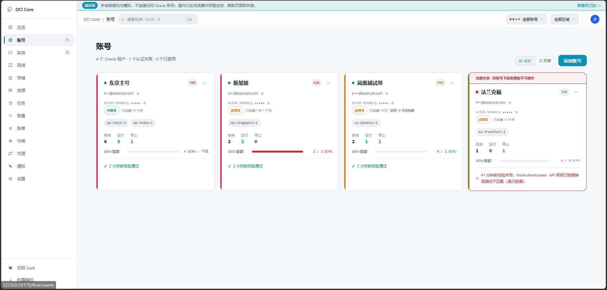</a><br><b>Accounts</b> · Connectivity status, permission self-check summary, trial countdown, account age, and quotas</td>
  <td width="50%" valign="top"><a href="docs/screenshots/resources.png">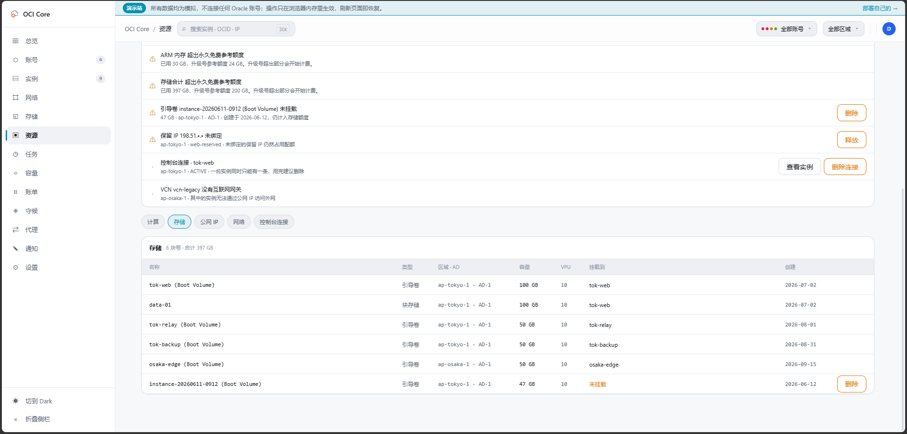</a><br><b>Resource inventory</b> · Usage vs. Always Free references with direct cleanup for orphaned volumes and unused reserved IPs</td>
</tr>
<tr>
  <td width="50%" valign="top"><a href="docs/screenshots/network.png">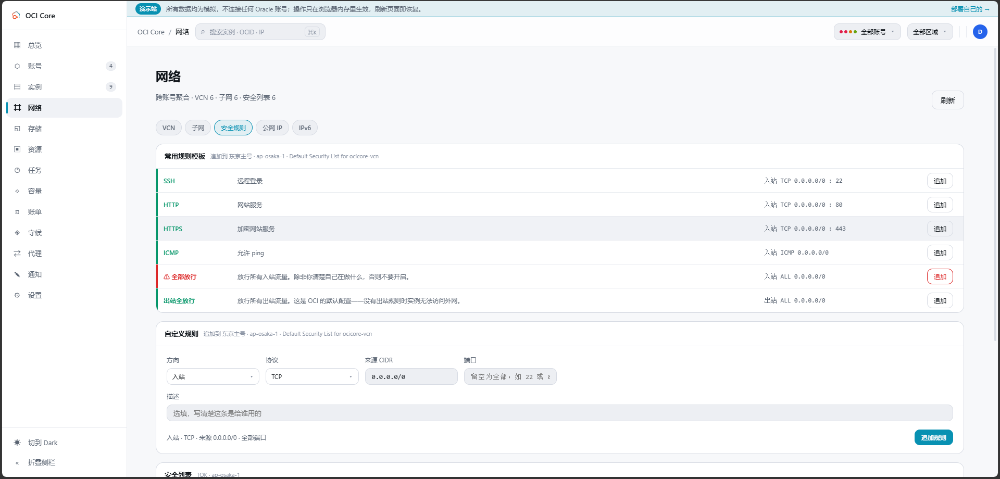</a><br><b>Security rules</b> · One-click common rule templates with explicit warnings for unrestricted ingress rules</td>
  <td width="50%" valign="top"><a href="docs/screenshots/billing.png">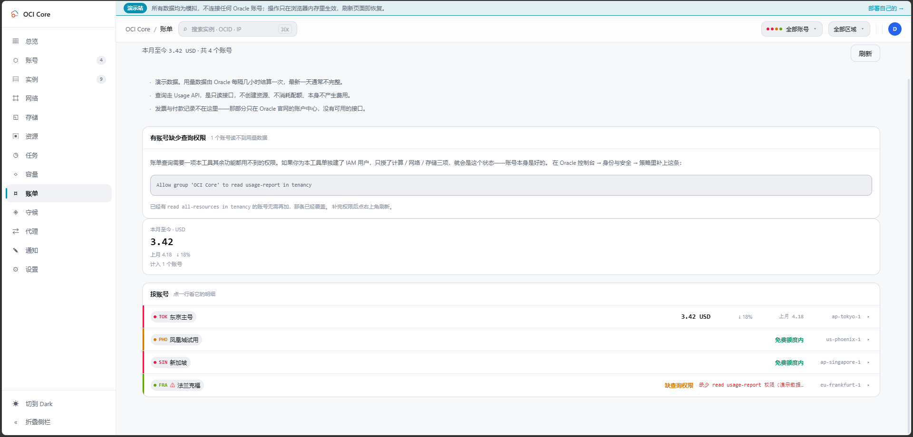</a><br><b>Billing</b> · Current and prior month cost breakdowns by service and SKU, or consumption metrics for free-tier accounts</td>
</tr>
</table>

</details>

<details>
<summary><b>Capacity</b> · Capacity Monitor · Capacity Hunter</summary>
<br>

<table>
<tr>
  <td width="50%" valign="top"><a href="docs/screenshots/capacity.png">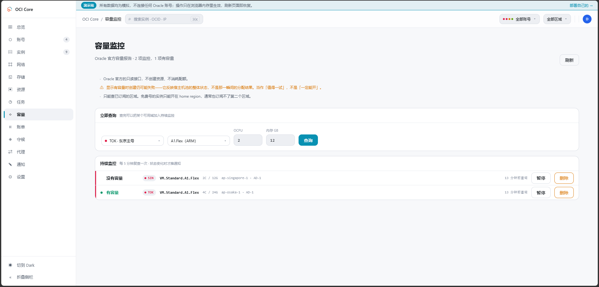</a><br><b>Capacity monitor</b> · Queries Oracle's read-only capacity report to track per-AD shape availability</td>
  <td width="50%" valign="top"><a href="docs/screenshots/hunt.png">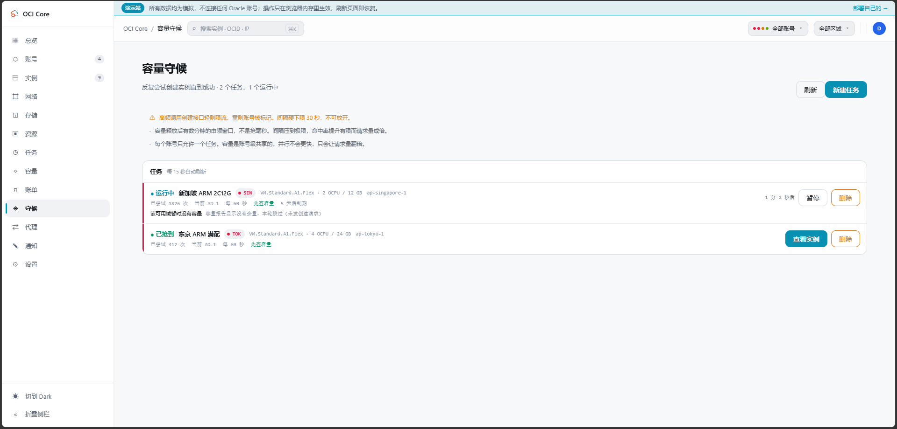</a><br><b>Capacity hunter</b> · Backoff-scheduled launch automation with read-only capacity pre-checks enabled by default</td>
</tr>
</table>

</details>

<details>
<summary><b>Settings</b> · Security · Policies · Audit Logs</summary>
<br>

<table>
<tr>
  <td width="50%" valign="top"><a href="docs/screenshots/settings.png">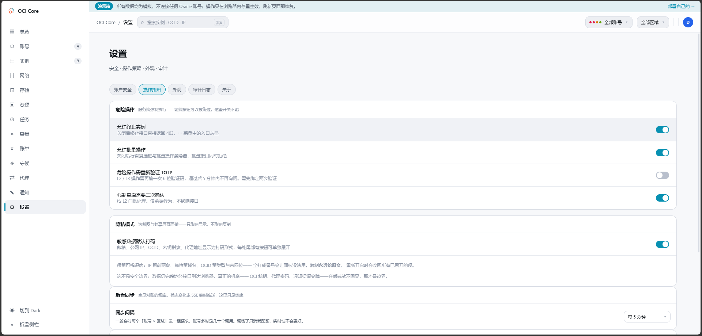</a><br><b>Settings</b> · Two-factor authentication, dangerous-action policies, local audit logs, and OCI cloud audit logs</td>
  <td width="50%"></td>
</tr>
</table>

</details>

---

## Deployment

### Docker Deployment (Recommended)

Requirements: Docker and Docker Compose.

#### 1. Pull prebuilt multi-arch images

CI publishes multi-architecture images (`linux/amd64` and `linux/arm64`) to GHCR, requiring neither Node.js nor Go on the host (fully compatible with Oracle Ampere A1 ARM instances):

```bash
git clone https://github.com/jsongmax/oci-core.git
cd oci-core
docker compose pull && docker compose up -d
```

Available tags (`ghcr.io/jsongmax/oci-core`):

| Tag | Target |
|---|---|
| `latest` | Latest stable release |
| `0.7.0` | Specific release version |
| `0.7` | Latest patch release on that minor line |
| `edge` | Latest commit on `main` (unreleased) |

#### 2. Build locally from source

To run local modifications or build independently of GHCR:

```bash
docker compose up -d --build
```

The image uses a three-stage build (Vite frontend → static Go binary → Alpine runtime), shipping only a single executable and a data directory.

Once started, open `http://127.0.0.1:8080` to complete administrator setup and TOTP two-factor enrollment.

#### 3. Upgrading

When using prebuilt images:

```bash
docker compose pull && docker compose up -d
```

When building from source:

```bash
git pull && docker compose up -d --build
```

Persistent data resides in a named volume, and database schema migrations execute automatically on startup.

> **Important**: **Never run `docker compose down -v`**. The `-v` flag removes the `ocicore_ocicore-data` volume, permanently destroying `master.key` and all encrypted OCI private keys.

---

### Prebuilt Binaries

Download release archives for five platforms (with `checksums.txt`) from [GitHub Releases](https://github.com/jsongmax/oci-core/releases):

| Platform | Archive |
|---|---|
| Linux x86_64 | `ocicore_<version>_linux_amd64.tar.gz` |
| **Linux ARM64** | `ocicore_<version>_linux_arm64.tar.gz` |
| macOS Apple Silicon | `ocicore_<version>_darwin_arm64.tar.gz` |
| macOS Intel | `ocicore_<version>_darwin_amd64.tar.gz` |
| Windows x86_64 | `ocicore_<version>_windows_amd64.zip` |

> Choose **`linux_arm64`** when hosting on an Oracle Always Free Ampere A1 ARM instance.

Extract and run with no runtime dependencies:

```bash
tar xzf ocicore_0.7.0_linux_arm64.tar.gz
./ocicore
```

By default the server listens on `127.0.0.1:8080`, stores data in `./data/`, and generates a master encryption key on first launch.

---

### Deployment Notes

<details>
<summary><b>1. Do not expose port <code>8080:8080</code> directly to the public internet</b></summary>
<br>

`docker-compose.yml` binds `127.0.0.1:8080:8080` (host loopback only). Because the panel holds control over all connected OCI tenancies, avoid exposing it directly on a public port. Use one of the following methods for remote access:

- **SSH port forwarding**:
  ```bash
  ssh -L 8080:127.0.0.1:8080 <your-server>
  ```
- **TLS reverse proxy**: Place Nginx, Caddy, or Cloudflare Tunnel in front of the service, and enable `OCICORE_TRUST_PROXY=true` **only** when the proxy reliably overwrites `X-Forwarded-For`. Enabling it without a trusted proxy allows callers to spoof headers and bypass login rate limiting.

</details>

<details>
<summary><b>2. Container processes must bind <code>0.0.0.0:8080</code></b></summary>
<br>

The binary binds `127.0.0.1:8080` by default, which is unreachable through Docker port mapping. The official image sets `OCICORE_ADDR=0.0.0.0:8080` in `ENV`; retain this variable if you write a custom `docker run` command. External exposure is still governed solely by the host `-p` mapping.

</details>

<details>
<summary><b>3. Back up the data directory together with <code>master.key</code></b></summary>
<br>

The data volume contains both `master.key` and the SQLite database (`oci-tools.db`). **Both files are required**:
- If `master.key` is missing, the server starts normally with a newly generated key, but previously encrypted private keys in the database become **permanently undecryptable**.
- Back up the entire data directory together and safeguard the archive as a secret.

Example backup for a Docker named volume:

```bash
# Confirm the actual volume name (including the Compose project prefix)
docker volume ls | grep ocicore

# Archive the entire data directory
docker run --rm -v ocicore_ocicore-data:/data -v "$PWD:/backup" \
  alpine tar czf /backup/ocicore-backup.tar.gz -C /data .
```

Restore by extracting the archive back into the target volume.

</details>

---

## OCI API Key & Least-Privilege IAM Setup

An OCI API key carries no permissions by itself; permissions are granted through IAM policies attached to the group(s) the user belongs to. **Creating a dedicated, least-privilege IAM user and group instead of using an `Administrators` key is strongly recommended.**

### Setup Steps

1. **Create a dedicated group and IAM user**
   In the OCI Console, navigate to **Identity & Security → Domains** and open the `Default` domain:
   - Under **Groups**, create a dedicated group (for example, `OCI Core`).
   - Under **Users**, create a dedicated IAM user and add it to the group.
2. **Generate an API key pair**
   Open the user's details → **API keys** → **Add API key** → **Generate API key pair**, then download the private key (`.pem`). After adding the key, copy the configuration preview (`user`, `fingerprint`, `tenancy`, `region`) and paste it directly into **Add Account → Paste OCI config** in OCI Core.
3. **Create a policy in the root compartment**
   Navigate to **Identity & Security → Identity → Policies**, select the **root compartment**, click **Create Policy**, enable **Show manual editor**, and paste the policy statements below.

### Recommended Policy Statements

Assuming the group name is `OCI Core` (if the user belongs to a non-default identity domain, use `'DomainName'/'GroupName'`):

```text
Allow group 'OCI Core' to manage instance-family in tenancy
Allow group 'OCI Core' to manage virtual-network-family in tenancy
Allow group 'OCI Core' to manage volume-family in tenancy
Allow group 'OCI Core' to manage compute-capacity-reports in tenancy
Allow group 'OCI Core' to read metrics in tenancy
Allow group 'OCI Core' to inspect limits in tenancy
Allow group 'OCI Core' to read resource-availability in tenancy
Allow group 'OCI Core' to read usage-report in tenancy
Allow group 'OCI Core' to read audit-events in tenancy
Allow group 'OCI Core' to inspect policies in tenancy
Allow group 'OCI Core' to inspect users in tenancy
Allow group 'OCI Core' to inspect groups in tenancy
```

### Statement Reference

| Statement | Scope | Purpose |
|---|---|---|
| `manage instance-family` | Core | Launch, terminate, start/stop, and reshape instances; serial console connections |
| `manage virtual-network-family` | Core | Edit security lists, manage ephemeral/reserved public IPs, IPv6, secondary VNICs, and private IPs |
| `manage volume-family` | Core | Resize boot/block volumes, tune VPUs, attach/detach, delete volumes, and rescue mode |
| `manage compute-capacity-reports` | Optional | Capacity checks, capacity monitor, and capacity hunter pre-checks |
| `read metrics` | Optional | Instance CPU, memory, and VNIC traffic metrics |
| `inspect limits` / `read resource-availability` | Optional | Service limits and Always Free quota references |
| `read usage-report` | Optional | Billing cost, usage breakdown, and outbound traffic tracking |
| `read audit-events` | Optional | OCI cloud audit log inspection |
| `inspect policies` / `users` / `groups` | Optional | Used exclusively by the permission self-check to read policies and group memberships |

### Key Notes

- **The `manage` verb is required**: In OCI, `use` does not grant permissions for launching/terminating instances, updating security lists, or creating IPv6 addresses; `compute-capacity-reports` is granted only by `manage`.
- **Omit unused optional permissions**: If you do not wish to grant billing, cloud audit, or capacity report access, simply omit those statements; the panel remains fully functional for all other features and displays clear notices where permissions are absent.
- **Compartment scoping**: To limit access to a specific compartment, replace `in tenancy` with `in compartment <name>`. Note that `compute-capacity-reports`, `limits`, `resource-availability`, and `usage-report` must remain `in tenancy` per OCI requirements.
- **Built-in permission self-check**: Once the connectivity test succeeds during account onboarding, OCI Core automatically runs a permission self-check (also re-runnable from the account details drawer). Omitting the last three `inspect` statements does not affect normal operations, though the self-check will rely solely on read-only probes and mark unprobed items as `Undetermined`.

---

## Configuration

All runtime settings are configured via environment variables (legacy `OCI_TOOLS_*` prefixes remain supported for backward compatibility):

| Variable | Default | Description |
|---|---|---|
| `OCICORE_ADDR` | `127.0.0.1:8080` | HTTP listen address (`0.0.0.0:8080` inside containers) |
| `OCICORE_DATA_DIR` | `./data` | Directory for the SQLite database and `master.key` |
| `OCICORE_MASTER_KEY` | empty | Hex-encoded master key; falls back to `$OCICORE_DATA_DIR/master.key` when unset |
| `OCICORE_STATIC_DIR` | empty | External static asset directory; overrides embedded `go:embed` assets when set (development) |
| `OCICORE_SESSION_TTL` | `12h` | Session lifetime (Go duration format, minimum `1m`) with sliding renewal |
| `OCICORE_TRUST_PROXY` | `false` | Trust `X-Forwarded-For` / `X-Forwarded-Proto`; enable only behind a controlled reverse proxy |
| `OCICORE_NOTIFY_ALLOWED_NETS` | empty | Additional CIDRs/IPs permitted for notification webhooks (comma-separated, e.g., `10.0.0.0/8,192.168.1.5`). Loopback, private, and link-local addresses are blocked by default; notification requests bypass `HTTP_PROXY`/`HTTPS_PROXY` |

Operational intervals and policies (background sync interval, credential re-check interval, local audit log retention, and dangerous-action confirmations) are configurable directly from the web UI.

---

## Security

Because OCI Core manages API credentials for all connected Oracle Cloud tenancies, follow these practices in production:

1. **Enforce least privilege**: Use a dedicated IAM user and minimal policy set as detailed in [OCI API Key & Least-Privilege IAM Setup](#oci-api-key--least-privilege-iam-setup), rather than an `Administrators` key.
2. **Avoid public cleartext exposure**: Keep loopback binding by default and access remotely over an SSH tunnel or TLS reverse proxy. Enable `OCICORE_TRUST_PROXY` only when your proxy overwrites `X-Forwarded-For`.
3. **Initialize immediately after deployment**: `GET /api/status` is publicly readable so the login screen can detect uninitialized instances. Create the administrator account and bind TOTP immediately after first startup.
4. **Enable TOTP and dangerous-action re-verification**: Turn on 2FA and require fresh TOTP verification for destructive operations (terminating instances, editing security lists, deleting volumes).
5. **Select egress proxies before onboarding**: Assign a proxy from the pool while adding an account so that both the initial connectivity test and all subsequent API traffic traverse the designated egress.
6. **Protect the master key**: OCI private keys are stored using AES-256-GCM envelope encryption (with AAD bound to the account ID), and the UI never exposes or exports private keys. Back up `master.key` securely offline and never commit it to source control.
7. **Zero external frontend dependencies**: The frontend loads no external CDNs or web fonts and enforces `Content-Security-Policy: default-src 'self'`, supporting air-gapped or private network deployments.

---

## Architecture & Tech Stack

### Tech Stack

| Layer | Choice | Notes |
|---|---|---|
| Backend | **Go 1.26** | Standard-library `net/http`, no web framework |
| Database | **SQLite** (`modernc.org/sqlite`) | Pure Go, no CGO, statically cross-compilable |
| OCI client | **Custom HTTP Signature** | draft-cavage, RSA-SHA256, tenant concurrency limits & error classification |
| Cryptography | **AES-256-GCM** · **Argon2id** · **RFC 6238 TOTP** | Envelope-encrypted private keys with account-bound AAD |
| Frontend | **Vue 3 + TypeScript + Vite** | Composition API, hand-written responsive CSS, zero-dependency `qrcode-generator` |
| Realtime | **SSE (Server-Sent Events)** | Server-pushed state transitions and job updates |
| Container | **Multi-stage Docker** | `node` → `golang` → `alpine` (`linux/amd64`, `linux/arm64`) |

### Repository Layout

```text
cmd/server          Entry point: configuration, storage setup, routing, graceful shutdown
internal/
  config            Environment variable parsing and validation
  ociclient         OCI REST client: signing, rate limiting, error taxonomy, compute / network / storage / limits / metrics / capacity / usage / subscription / audit
  ociconn           Per-account OCI client factory (sole decryption point for private keys)
  cryptobox         AES-256-GCM envelope encryption
  store             SQLite persistence: accounts, users, sessions, instance cache, jobs, proxies, notifications, audit, capacity watches, hunt tasks
  auth              Argon2id password hashing, TOTP verification, session tokens
  i18n              Server-side Simplified Chinese and English catalogs
  accountsvc        Multi-step account connectivity checks
  permsvc           IAM policy parser and read-only probe permission self-check
  instancesvc       Cross-account instance aggregation, lifecycle orchestration, SSE bus
  netsvc            VCN provisioning, public IP lifecycle, IPv6, security rule templates
  jobsvc            Asynchronous background job execution and recovery
  huntsvc           Capacity hunter scheduler (backoff, AD rotation, deduplication)
  capacitysvc       Read-only capacity monitor polling
  billingsvc        Cost and usage aggregation (OCI Usage API)
  proxypool         Proxy parser, liveness checks, 1:1 binding constraints
  notify            Multi-channel notification dispatcher with SSRF protection
  httpapi           REST API layer, session authentication, dangerous-action elevation
  web               go:embed wrapper for built frontend assets
web/                Frontend source code (Vue 3 + TypeScript + Vite)
docs/
  API.md                REST API reference
  FRONTEND-DESIGN.md    UI and interaction specification
  CAPACITY-HUNTER.md    Capacity hunter design notes
```

<details>
<summary><b>Key Architectural Decisions</b></summary>
<br>

- **Custom OCI signing over the official SDK**: OCI uses standard draft-cavage HTTP Signatures implementable in ~100 lines, yielding a minimal dependency footprint and centralized retry/error classification in [`internal/ociclient/errors.go`](internal/ociclient/errors.go).
- **Cached instance views with fault isolation**: Periodic background sync persists instance metadata into SQLite for instant list rendering, while live transitions stream over SSE. Sync failures are isolated per `(account × region)` so one degraded account never clears the rest of the inventory.
- **Transitional-state responses**: Power actions return transitional states (`STARTING` / `STOPPING`) rather than assuming completion; settled states are confirmed via background polling and pushed over SSE.
- **Server-side enforcement for destructive actions**: Terminating an instance requires echoing its name, deleting an account requires echoing its alias, and disabled dangerous-action policies return `403` directly from the server.
- **Custom-header CSRF protection**: Because CORS is never enabled, requiring `X-OCI-Tools: 1` on all mutating endpoints reliably blocks cross-origin requests without token synchronization complexity.
- **Read-only pre-checks for Capacity Hunter**: Querying the read-only capacity report before calling `LaunchInstance` significantly reduces unnecessary launch requests.
- **Color bars paired with mandatory short codes**: Short account codes ensure accessible multi-account identification without relying on color alone.

</details>

---

## Local Development

Requirements: **Go 1.26+** and **Node.js 18+** (CI uses Node.js 24).

### Run the Backend

```bash
go run ./cmd/server
```

Listens on `127.0.0.1:8080` and stores local state in `./data/`.

### Frontend Development

```bash
cd web
npm install
npm run dev
```

The Vite dev server runs on `http://127.0.0.1:5173` and proxies `/api` requests to `127.0.0.1:8080`. To serve built frontend assets directly from disk without rebuilding Go:

```bash
OCICORE_STATIC_DIR=./internal/web/dist go run ./cmd/server
```

### Build Frontend & Single Binary

```bash
# Rebuild frontend assets only when web/ changes (outputs to internal/web/dist)
cd web && npm run build

# Build the single binary (requires internal/web/dist to exist at compile time)
cd ..
go build -trimpath -ldflags "-s -w -X main.version=0.7.0" -o dist/ocicore ./cmd/server
```

### Build the Demo Site

The live demo is a standalone frontend build whose API calls are handled in-browser by `web/src/demo/server.ts` using synthetic data (standard `npm run build` tree-shakes all demo code away). Pushing a `v*` tag automatically deploys it to GitHub Pages via `.github/workflows/pages.yml`:

```bash
cd web && npm run build:demo   # outputs to web/dist-demo
```

### Tests & Checks

```bash
gofmt -l internal cmd
go vet ./...
go test -count=1 ./...
cd web && npm run typecheck
```

> If your `go env` sets `GOOS=linux`, override the target platform when running tests on Windows:
> ```bash
> GOOS=windows GOARCH=amd64 go test -count=1 ./...
> ```

### Commit Convention

This repository follows [Conventional Commits](https://www.conventionalcommits.org/) with English type prefixes and concise descriptions (e.g., `feat: add OCI cloud audit log viewer`, `fix(billing): refine outbound transfer aggregation`).

---

## Known Limitations

- Instance metrics depend on the Oracle Cloud Agent running inside the guest OS; without it, API calls succeed with empty series.
- Capacity reports reflect host pool state at query time; an available report does not guarantee a launch will succeed under concurrent demand.
- Capacity monitoring can only query subscribed regions; Always Free accounts are typically limited to their home region.
- Billing data is settled asynchronously by Oracle on an hourly/multi-hour cadence, so same-day figures are delayed and do not reflect real-time spend.
- Invoices and payment records reside in Oracle Account Center outside the OCI signing scheme and have no public API.
- OCI cloud audit logs are retained for up to **365 days**, and each query scopes to a single compartment (excluding child compartments).
- Growing a guest OS partition after resizing a boot volume still requires running the panel-generated commands inside the instance (OCI Run Command is not integrated).
- Outbound transfer totals are aggregated by SKU name using the raw units returned by Oracle.
- Volume auto-tuning, instance configurations, instance pools, and automated backup/snapshot policies are not yet implemented.

---

## Disclaimer

**Please read carefully before using this software:**

1. **No Oracle affiliation**: This project is an independent open-source project and is not affiliated with, endorsed by, or sponsored by Oracle Corporation. Oracle, Oracle Cloud, and OCI are registered trademarks of Oracle Corporation.
2. **Terms of Service compliance**: You are solely responsible for ensuring your usage complies with Oracle Cloud's Terms of Service. In particular, the Capacity Hunter repeatedly invokes instance-launch APIs; high-frequency requests may trigger rate limiting or account enforcement. Despite built-in backoff, rate floors, and warnings, all operational risk remains with the user.
3. **Credential custody**: This software stores encrypted OCI API private keys locally. Follow the [Security](#security) guidelines, avoid exposing the panel directly to the public internet, and use a dedicated least-privilege IAM user.
4. **Irreversible actions and backups**: Terminating instances, deleting volumes, and releasing reserved IPs are irreversible; losing `master.key` renders all stored private keys permanently undecryptable. Maintain independent backups.
5. **AI-assisted development**: Portions of this codebase were authored with the assistance of AI coding tools, with architecture, review, and testing overseen by the maintainer. Independently evaluate the codebase against your own security standards before connecting critical accounts.
6. **No warranty**: This software is provided "AS IS", without warranty of any kind. See [LICENSE](LICENSE) for details.

---

## License

[MIT License](LICENSE) © 2026 jsongmax
