<div align="center">

# OCI Core

**自托管的 Oracle Cloud Infrastructure (OCI) 多账号管理面板**

将分散在多个 OCI 租户与区域中的计算、网络、存储、账单与审计资源统一收拢到单一控制台，避免在官方控制台间频繁切换。

[](https://github.com/jsongmax/oci-core/releases)
[](https://github.com/jsongmax/oci-core/actions/workflows/ci.yml)
[](LICENSE)
[](https://go.dev)
[](https://vuejs.org)
[](#docker-部署推荐)

**[在线演示 →](https://jsongmax.github.io/oci-core/)**（使用内置模拟数据，不连接任何实际 Oracle 账号）

简体中文 · [English](README.en.md)

</div>

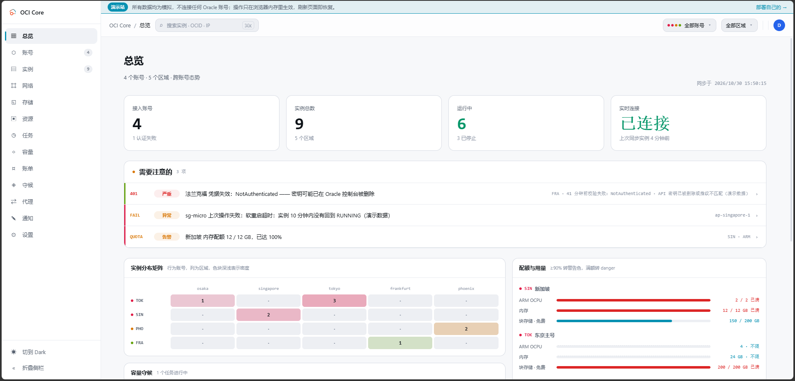

---

## 目录

- [项目简介](#项目简介)
- [核心功能](#核心功能)
- [界面预览](#界面预览)
- [快速部署](#快速部署)
  - [Docker 部署（推荐）](#docker-部署推荐)
  - [预编译二进制部署](#预编译二进制部署)
  - [部署注意事项](#部署注意事项)
- [OCI API 密钥与最小权限配置](#oci-api-密钥与最小权限配置)
- [环境变量配置](#环境变量配置)
- [安全须知](#安全须知)
- [架构与技术栈](#架构与技术栈)
- [本地开发](#本地开发)
- [已知限制](#已知限制)
- [免责声明](#免责声明)
- [开源协议](#开源协议)

---

## 项目简介

OCI Core 是一款面向自托管场景的轻量级单二进制 Web 管理面板，用于集中管理多个 Oracle Cloud 账号下的基础设施资源。

- **单二进制部署**：前端静态资源通过 `go:embed` 编译进可执行文件，支持静态链接与多架构容器镜像，无额外运行时依赖。
- **轻量级 OCI 接入**：自行实现 draft-cavage HTTP Signature（RSA-SHA256），不依赖体积庞大的官方 SDK，依赖树精简且重试与错误分类完全可控。
- **本地化数据存储**：采用纯 Go SQLite（`modernc.org/sqlite`）与本地主密钥加密托管，所有数据与凭据均留存于本地，不向任何第三方上报。

> **当前不在支持范围内**：Oracle 账户中心的发票与付款记录（官方未提供基于 OCI 签名的开放接口）、多用户 Web 后台 RBAC。

---

## 核心功能

### 账号与实例管理
- **多租户账号接入**：支持粘贴 OCI `config` 自动解析、逐项连通性校验、账号类型识别（试用 / 升级）、开户天数与配额查询、定期凭据复查、私钥加密存储与密钥轮换。
- **功能权限自检**：接入账号时或随时按需结合 IAM 策略解析与只读接口探测，逐项评估各功能权限状态（可用 / 缺失 / 无法判断），并为缺失项生成可直接复制的修复策略。
- **跨账号实例聚合**：统一展示多账号、多区域实例（SQLite 缓存加速 + SSE 实时状态推送），支持自定义列显隐与排序、生命周期控制（启停 / 重启 / 终止）、在线调整配置（含突发 CPU）、重命名、备注、批量操作、SSH 默认用户推断及创建向导（支持免费预设与可用域内全部可用规格）。
- **后台任务队列**：创建实例、更换公网 IP、调整配置、增删网卡、修改云盘与批量操作均以异步任务执行，支持实时查看步骤进度与失败详情，同实例操作按序串行避免冲突。

### 网络与存储
- **虚拟云网络**：可视化编辑 VCN、子网与安全列表规则（支持常用规则模板与一键自动建网），按账号分组管理。
- **多 IPv4 与预留公网 IP**：支持主网卡与附属网卡增删辅助私网 IPv4，按私网槽位独立管理临时与预留公网 IP（新建、绑定、切换、无损解绑与释放），支持跨账号/区域预留 IP 集中管理与公网 IP 批量更换（含乐观并发校验）。
- **IPv6 与附属网卡**：支持为创建中的或已有实例的任意网卡分配与移除多个 IPv6 地址（展示创建时间），以及动态添加与分离附属网卡。
- **块存储与救援模式**：支持引导卷与数据卷扩容、VPU 性能调整、分离与挂载；扩容后按操作系统生成重扫磁盘与扩展分区命令；内置**引导卷救援模式**工作流（分离故障引导卷 → 挂载至救援实例修复 → 挂回原实例）。

### 监控、资源盘点、账单与容量
- **性能与流量监控**：展示 CPU、内存及双向网络流量时间序列（采样粒度随时间跨度自适应），并基于 VCN 网卡指标统计自然月出入站流量（不依赖 Cloud Agent）。
- **资源盘点与清理**：按账号汇总各区域卷、公网 IP（含预留 IP）、控制台连接与 VCN，对照 Oracle 限额及 Always Free 参考额度，高亮孤立卷、闲置预留 IP、遗留控制台连接及缺少互联网网关的 VCN 并支持就地清理。
- **账单与用量分析**：通过 OCI Usage API 聚合本月/上月费用、日趋势以及按服务、区域与计费项的明细分解；单独汇总出站流量并对比每月 10 TB 免费额度；免费账号自动切换展示实际资源用量（OCPU 小时 / GB 月）。
- **容量监控与容量守候**：通过官方**只读**容量报告接口监测指定规格在各可用域的库存变化并推送通知；容量守候支持在有库存时自动尝试创建实例（默认启用只读容量预检，避免无效创建请求）。

### 安全与审计
- **认证与防护**：Argon2id 口令哈希、TOTP 双因子认证（支持扫码绑定及 1Password 等密码管理器自动填充）、会话管理与强制下线、自定义请求头 CSRF 防护、登录失败限流、危险操作三级确认与服务端 TOTP 复核。
- **双轨审计日志**：同时提供**面板本地操作审计**（游标分页、全量 CSV 导出、可选保留天数）与 **OCI 官方云端审计日志（Audit）**（按账号、已订阅区域与多层子区间查询，标注主区域 Home Region，支持游标分页、关键词/写操作/失败筛选、敏感令牌头自动脱敏、隐私模式原始 JSON 遮罩及 365 天保留期提示）。
- **隐私保护模式**：邮箱、公网 IP、OCID、指纹等敏感字段默认打码，支持单处临时展开与顶栏一键全局切换，复制操作始终输出原文，便于截图与演示。
- **身份域登录策略**：支持读取与修改租户身份域的密码过期时间，写入后自动回读校验服务端实际生效值。

### 运维与扩展
- **远程控制台**：快速生成串行控制台与 VNC 隧道连接命令（仅接收用户公钥，不托管私钥）。
- **独立代理池**：支持四种常见格式批量导入代理、存活与延迟检测，并强制一对一绑定至账号出口（首次连通性测试即走指定代理）。
- **多渠道通知与双语支持**：支持 Telegram、企业微信、钉钉、邮件与 Webhook 通知及细粒度事件订阅矩阵；界面与接口消息完整支持简体中文与 English，通知语言可独立配置。

---

## 界面预览

以下截图均来自[在线演示站点](https://jsongmax.github.io/oci-core/)（模拟数据）。点击图片可查看原图，点击分组标题可展开其余视图。

<details open>
<summary><b>实例与任务</b> · 实例列表 · 创建向导 · 实例详情 · 后台任务</summary>
<br>

<table>
<tr>
  <td width="50%" valign="top"><a href="docs/screenshots/instances.png">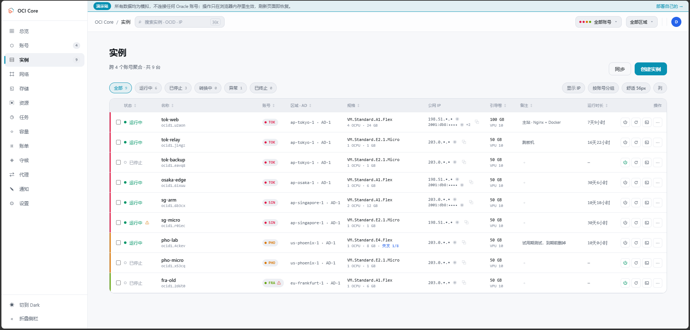</a><br><b>实例列表</b> · 跨账号聚合展示，以色条与短代号标识归属，支持自定义列与公网 IP 一键显隐</td>
  <td width="50%" valign="top"><a href="docs/screenshots/create-instance.png">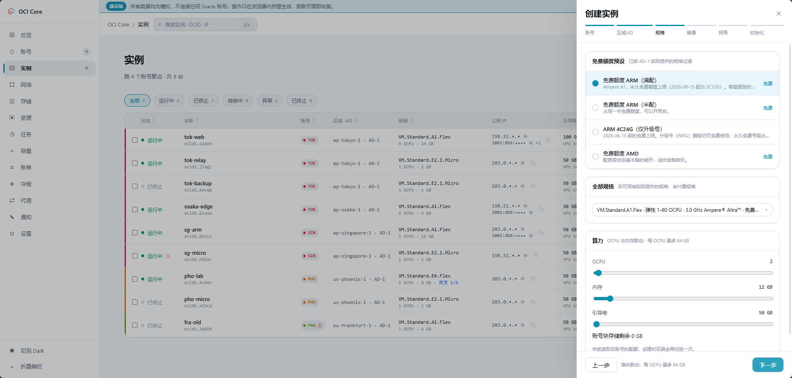</a><br><b>创建向导</b> · 提供免费预设及目标可用域内全部可选规格，镜像按 CPU 架构自动过滤</td>
</tr>
<tr>
  <td width="50%" valign="top"><a href="docs/screenshots/instance-network.png">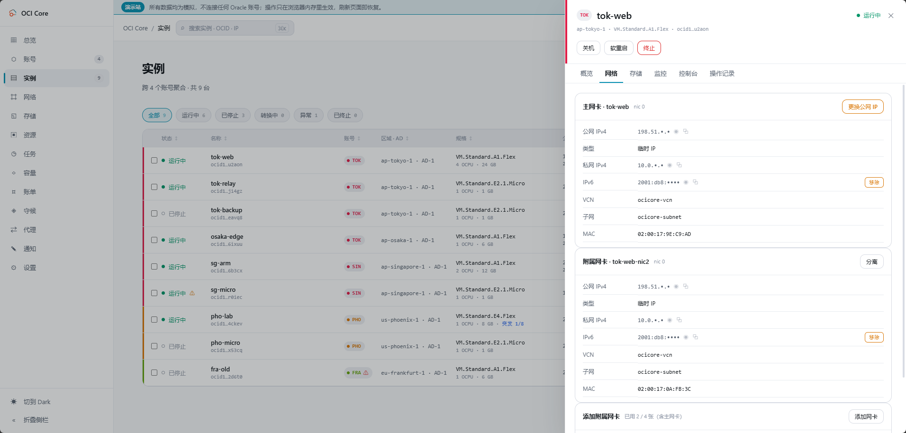</a><br><b>实例网络</b> · 主网卡与附属网卡统一管理，支持多 IPv4、预留/临时公网 IP 切换与 IPv6 增删</td>
  <td width="50%" valign="top"><a href="docs/screenshots/instance-storage.png">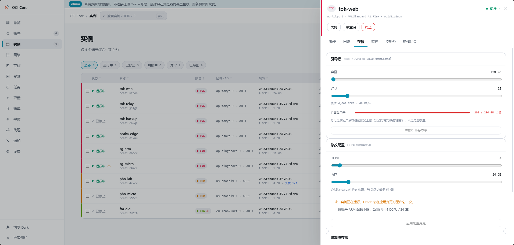</a><br><b>存储与配置</b> · 引导卷扩容与 VPU 滑块调节，实例改配时自动联动 OCPU 与内存规格</td>
</tr>
<tr>
  <td width="50%" valign="top"><a href="docs/screenshots/instance-rescue.png">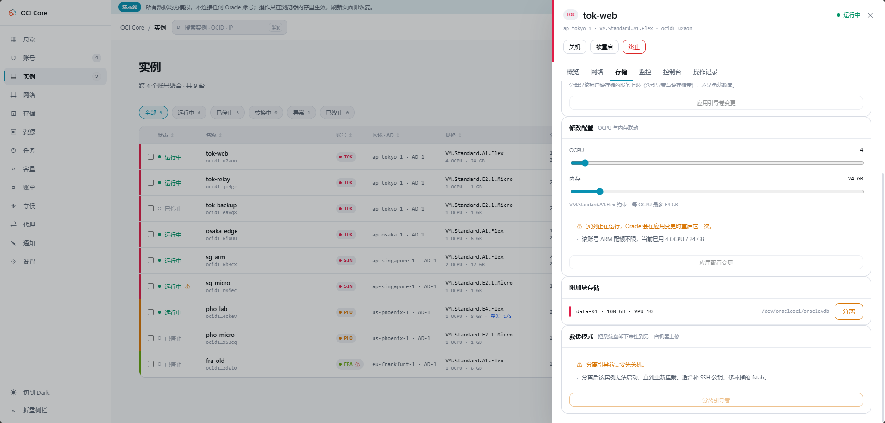</a><br><b>救援模式</b> · 引导分离故障系统盘、挂载至救援实例修复文件后再安全挂回</td>
  <td width="50%" valign="top"><a href="docs/screenshots/instance-metrics.png">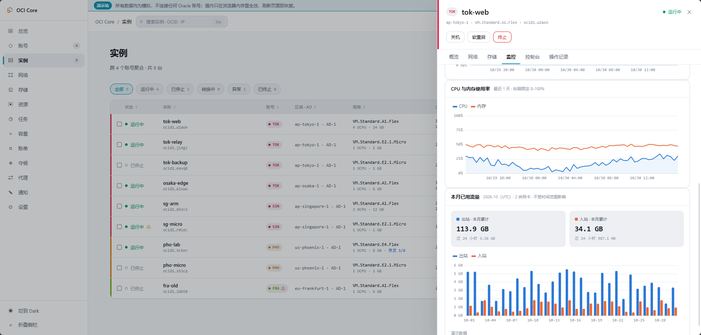</a><br><b>性能监控</b> · CPU、内存时序曲线与自然月出入站流量统计，采样粒度随跨度自适应</td>
</tr>
<tr>
  <td width="50%" valign="top"><a href="docs/screenshots/instance-console.png">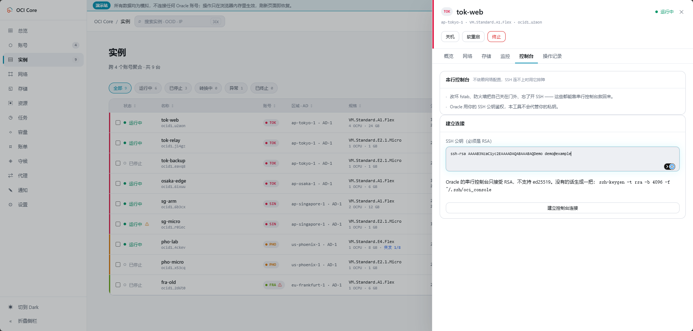</a><br><b>串行控制台</b> · 用于 SSH 异常时的带外排障；仅接受 RSA 公钥，不托管私钥</td>
  <td width="50%" valign="top"><a href="docs/screenshots/jobs.png">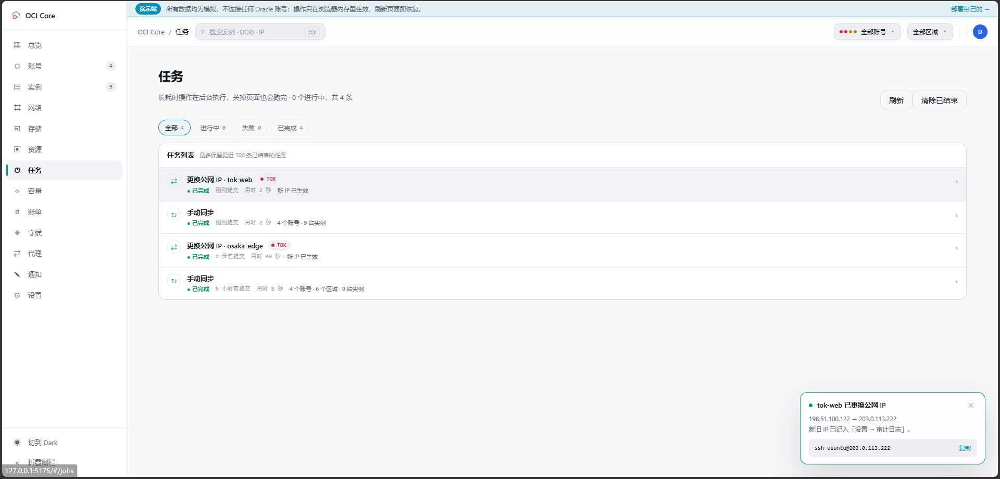</a><br><b>后台任务</b> · 异步执行长耗时操作，实时呈现执行步骤与错误信息</td>
</tr>
</table>

</details>

<details>
<summary><b>账号与资源</b> · 账号管理 · 资源盘点 · 网络安全 · 账单分析</summary>
<br>

<table>
<tr>
  <td width="50%" valign="top"><a href="docs/screenshots/accounts.png">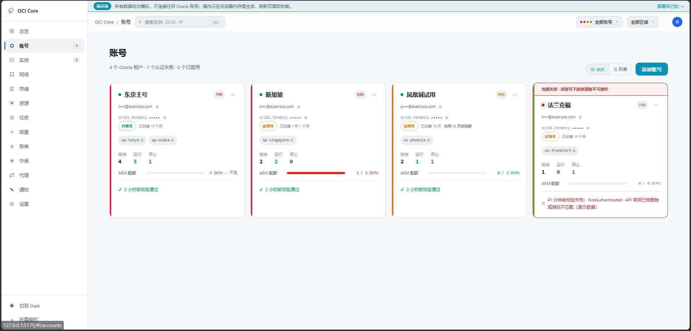</a><br><b>账号管理</b> · 集中展示连通状态、权限自检概要、试用倒计时、开户天数与配额信息</td>
  <td width="50%" valign="top"><a href="docs/screenshots/resources.png">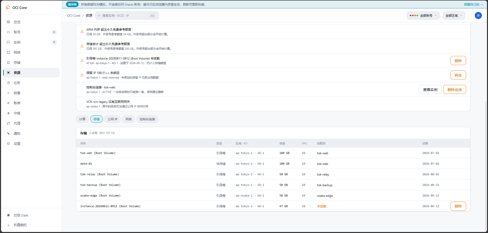</a><br><b>资源盘点</b> · 对照免费参考额度，识别并清理孤立存储卷、闲置预留 IP 与遗留连接</td>
</tr>
<tr>
  <td width="50%" valign="top"><a href="docs/screenshots/network.png">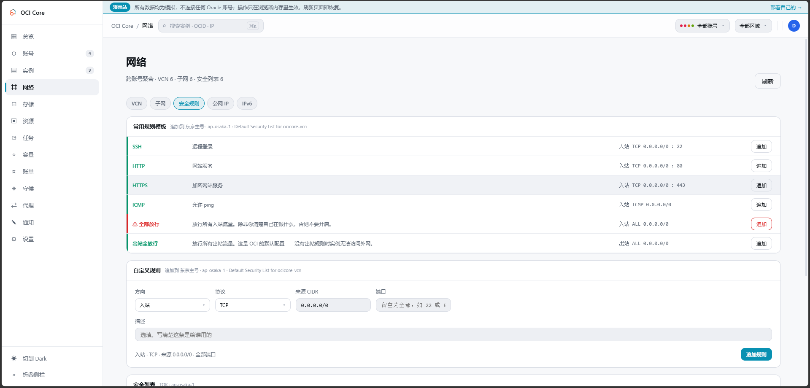</a><br><b>安全规则</b> · 支持规则模板快捷追加，对全网放行规则提供明确风险提示</td>
  <td width="50%" valign="top"><a href="docs/screenshots/billing.png">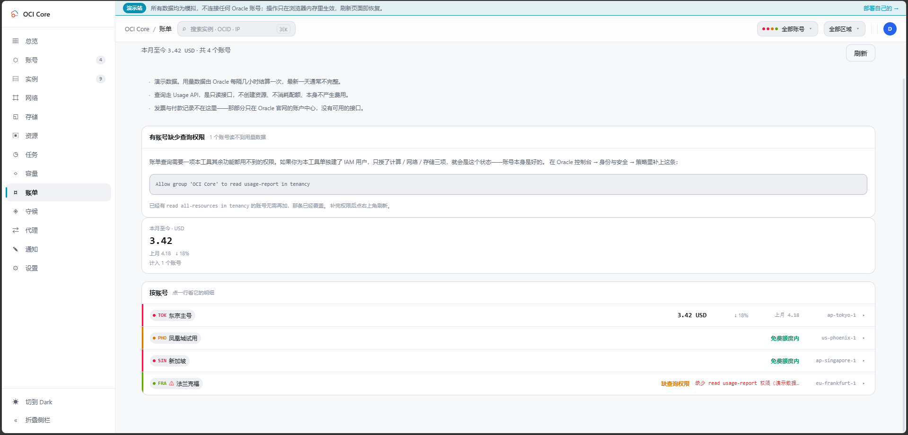</a><br><b>账单分析</b> · 展示本月与上月费用及明细拆分，免费账号自动切换至实际资源用量视图</td>
</tr>
</table>

</details>

<details>
<summary><b>容量管理</b> · 容量监控 · 容量守候</summary>
<br>

<table>
<tr>
  <td width="50%" valign="top"><a href="docs/screenshots/capacity.png">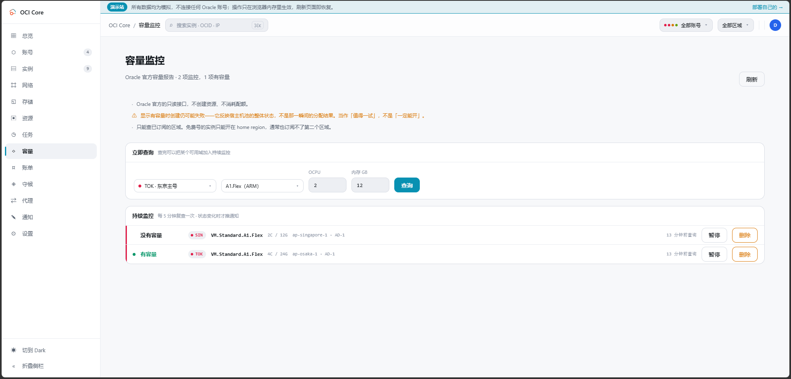</a><br><b>容量监控</b> · 调用官方只读容量报告接口，实时跟踪目标规格在各可用域的库存状态</td>
  <td width="50%" valign="top"><a href="docs/screenshots/hunt.png">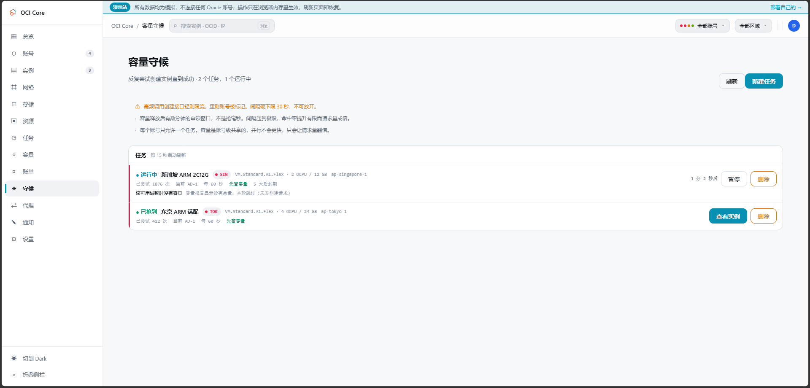</a><br><b>容量守候</b> · 支持只读预检与退避调度，在检测到可用容量时自动发起实例创建</td>
</tr>
</table>

</details>

<details>
<summary><b>系统设置</b> · 账户安全 · 操作策略 · 审计日志</summary>
<br>

<table>
<tr>
  <td width="50%" valign="top"><a href="docs/screenshots/settings.png">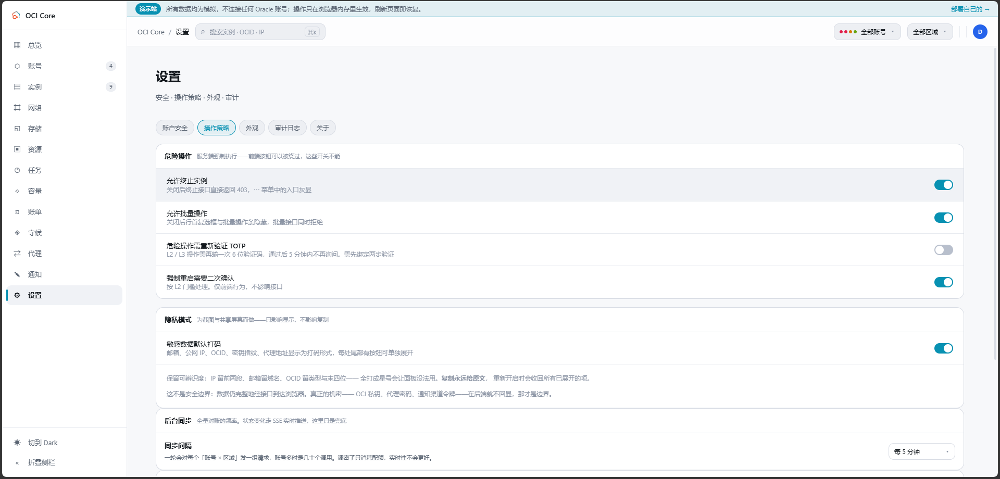</a><br><b>系统设置</b> · 配置两步验证、危险操作策略、本地操作审计与 OCI 官方云端审计日志</td>
  <td width="50%"></td>
</tr>
</table>

</details>

---

## 快速部署

### Docker 部署（推荐）

环境要求：Docker 与 Docker Compose。

#### 1. 使用预构建镜像

CI 自动构建并发布 `linux/amd64` 与 `linux/arm64` 双架构镜像至 GHCR，服务端无需安装 Node.js 或 Go（兼容 Oracle Ampere A1 ARM 实例）：

```bash
git clone https://github.com/jsongmax/oci-core.git
cd oci-core
docker compose pull && docker compose up -d
```

可用镜像标签（`ghcr.io/jsongmax/oci-core`）：

| 标签 | 说明 |
|---|---|
| `latest` | 最新正式发布版本 |
| `0.7.0` | 指定精确版本 |
| `0.7` | 对应次版本线的最新补丁版本 |
| `edge` | `main` 分支最新提交（开发预览版） |

#### 2. 从源码构建镜像

如需基于本地修改构建或避免依赖外部镜像源：

```bash
docker compose up -d --build
```

`docker-compose.yml` 采用三阶段构建（Vite 前端构建 → Go 静态编译 → Alpine 运行时），最终运行时镜像仅包含单一可执行文件与数据目录。

启动完成后，访问 `http://127.0.0.1:8080` 按页面向导完成管理员初始化与 TOTP 两步验证绑定。

#### 3. 升级服务

使用预构建镜像升级：

```bash
docker compose pull && docker compose up -d
```

使用本地源码重新构建升级：

```bash
git pull && docker compose up -d --build
```

数据存储在命名卷中，重建容器不会丢失数据，数据库结构迁移会在服务启动时自动执行。

> **重要提示**：升级或停机时**切勿执行 `docker compose down -v`**，`-v` 参数会删除数据卷 `ocicore_ocicore-data`，导致 `master.key` 与所有已加密存储的私钥永久丢失。

---

### 预编译二进制部署

可在 [GitHub Releases](https://github.com/jsongmax/oci-core/releases) 下载对应平台的预编译发布包（每次发版均附带 `checksums.txt` 用于校验）：

| 平台 | 文件名 |
|---|---|
| Linux x86_64 | `ocicore_<版本>_linux_amd64.tar.gz` |
| **Linux ARM64** | `ocicore_<版本>_linux_arm64.tar.gz` |
| macOS Apple Silicon | `ocicore_<版本>_darwin_arm64.tar.gz` |
| macOS Intel | `ocicore_<版本>_darwin_amd64.tar.gz` |
| Windows x86_64 | `ocicore_<版本>_windows_amd64.zip` |

> 若部署在 Oracle Always Free 的 Ampere A1 ARM 实例上，请选择 **`linux_arm64`** 发布包。

解压后直接运行，无运行时依赖：

```bash
tar xzf ocicore_0.7.0_linux_arm64.tar.gz
./ocicore
```

默认监听 `127.0.0.1:8080`，数据写入当前目录下的 `./data/`，首次启动自动生成加密主密钥。

---

### 部署注意事项

<details>
<summary><b>1. 请勿将端口直接暴露至公网（避免使用 <code>8080:8080</code>）</b></summary>
<br>

`docker-compose.yml` 默认配置为 `127.0.0.1:8080:8080`，仅绑定宿主机回环地址。由于面板托管了多个 OCI 租户的控制权，请勿将其直接监听在公网端口。推荐使用以下两种远程访问方式之一：

- **SSH 端口转发**：
  ```bash
  ssh -L 8080:127.0.0.1:8080 <your-server>
  ```
- **TLS 反向代理**：在前端部署 Nginx、Caddy 或 Cloudflare Tunnel，并**仅在此场景下**设置 `OCICORE_TRUST_PROXY=true`（代理层须正确覆写 `X-Forwarded-For`）。若未部署反代而开启该选项，客户端可通过伪造请求头绕过登录限流。

</details>

<details>
<summary><b>2. 容器内部监听地址须为 <code>0.0.0.0:8080</code></b></summary>
<br>

程序默认监听 `127.0.0.1:8080`，该地址在容器内部无法被宿主机端口映射访问。官方镜像已在环境变量中预设 `OCICORE_ADDR=0.0.0.0:8080`；若使用自定义 `docker run` 命令，请保留该环境变量，是否对外暴露由宿主机 `-p` 参数控制。

</details>

<details>
<summary><b>3. 妥善备份数据目录与 <code>master.key</code></b></summary>
<br>

数据卷中同时保存 `master.key` 与 SQLite 数据库（`oci-tools.db`），**两者缺一不可**：
- 丢失 `master.key` 后，服务启动时会自动生成新密钥且不会阻断启动，但数据库中原有的加密私钥将**永久无法解密**。
- 请定期将整个数据目录一并备份，并将备份归档视作敏感私钥严格保管。

Docker 命名卷备份示例：

```bash
# 确认实际卷名（含 Compose 项目前缀）
docker volume ls | grep ocicore

# 打包备份整个数据目录
docker run --rm -v ocicore_ocicore-data:/data -v "$PWD:/backup" \
  alpine tar czf /backup/ocicore-backup.tar.gz -C /data .
```

恢复时将归档反向解压回目标数据卷即可。

</details>

---

## OCI API 密钥与最小权限配置

OCI 的 API 密钥本身不携带权限，所有访问权限均通过 IAM 策略授予该用户所属的组。**强烈建议为本面板创建专用 IAM 用户与用户组，按最小权限原则授权，避免使用 `Administrators` 组密钥。**

### 配置步骤

1. **创建用户组与专用用户**
   登录 OCI 控制台，进入 **Identity & Security → Domains**，选择 `Default` 域：
   - 在 **Groups** 中新建专用组（例如 `OCI Core`）。
   - 在 **Users** 中创建专用 IAM 用户，并将其加入该组。
2. **生成 API 密钥对**
   进入该用户详情页 → **API keys** → **Add API key** → **Generate API key pair**，下载生成的私钥文件（`.pem`）。提交后页面会展示配置预览（包含 `user`、`fingerprint`、`tenancy`、`region`），可直接粘贴到本面板的「添加账号 → 粘贴 OCI config」中自动解析。
3. **在根区间创建访问策略**
   进入 **Identity & Security → Identity → Policies**，将左侧区间（Compartment）切换为**根区间（root compartment）** → 点击 **Create Policy** → 开启 **Show manual editor**，粘贴下方策略语句并保存。

### 推荐策略语句

以用户组名为 `OCI Core` 为例（如用户不在 `Default` 域中，组名须写为 `'DomainName'/'GroupName'` 格式）：

```text
Allow group 'OCI Core' to manage instance-family in tenancy
Allow group 'OCI Core' to manage virtual-network-family in tenancy
Allow group 'OCI Core' to manage volume-family in tenancy
Allow group 'OCI Core' to manage compute-capacity-reports in tenancy
Allow group 'OCI Core' to read metrics in tenancy
Allow group 'OCI Core' to inspect limits in tenancy
Allow group 'OCI Core' to read resource-availability in tenancy
Allow group 'OCI Core' to read usage-report in tenancy
Allow group 'OCI Core' to read audit-events in tenancy
Allow group 'OCI Core' to inspect policies in tenancy
Allow group 'OCI Core' to inspect users in tenancy
Allow group 'OCI Core' to inspect groups in tenancy
```

### 策略用途对照表

| 策略语句 | 类型 | 对应功能 |
|---|---|---|
| `manage instance-family` | 核心 | 实例创建、终止、启停、修改配置、串行控制台连接 |
| `manage virtual-network-family` | 核心 | 安全列表编辑、临时/预留公网 IP 管理、IPv6、附属网卡与辅助私网 IP |
| `manage volume-family` | 核心 | 引导卷/数据卷扩容、VPU 调整、挂载/分离、删除卷与救援模式 |
| `manage compute-capacity-reports` | 可选 | 容量查询、容量监控与容量守候的只读预检 |
| `read metrics` | 可选 | 实例 CPU、内存与网卡流量监控指标 |
| `inspect limits` / `read resource-availability` | 可选 | 服务配额查询与免费额度参考对比 |
| `read usage-report` | 可选 | 账单成本、资源用量与出站流量统计 |
| `read audit-events` | 可选 | OCI 官方云端审计日志（Audit）查询 |
| `inspect policies` / `users` / `groups` | 可选 | 仅供「权限自检」读取策略与组成员关系，不影响日常操作 |

### 配置要点

- **动词须使用 `manage`**：对于实例、网络与存储，OCI 的 `use` 动词不包含创建/终止实例、修改安全列表、增删 IPv6 等权限；`compute-capacity-reports` 亦仅由 `manage` 授予。
- **按需精简可选权限**：若不需要在面板中查看账单、云端审计日志或容量报告，直接省略对应 `read` / `manage` 语句即可，不影响其余功能；缺少权限时面板会给出明确提示。
- **限定至特定子区间**：如需将权限收窄到指定区间，可将上述语句中的 `in tenancy` 替换为 `in compartment <区间名>`；但 `compute-capacity-reports`、`limits`、`resource-availability` 与 `usage-report` 受 OCI 平台限制，必须保留 `in tenancy`。
- **内置权限自检**：添加账号通过连通性测试后，面板会自动运行一次权限自检；后续也可在账号详情的「权限自检」页重新检测并获取缺失项的修复语句。若省略了末尾三条 `inspect` 语句，自检将仅依赖只读探测，其余项会标记为「无法判断」。

---

## 环境变量配置

全部运行期配置均通过环境变量注入（同时向后兼容历史前缀 `OCI_TOOLS_*`）：

| 变量名 | 默认值 | 说明 |
|---|---|---|
| `OCICORE_ADDR` | `127.0.0.1:8080` | HTTP 监听地址；容器内须设为 `0.0.0.0:8080` |
| `OCICORE_DATA_DIR` | `./data` | SQLite 数据库与 `master.key` 存储目录 |
| `OCICORE_MASTER_KEY` | 空 | 十六进制加密主密钥；留空时自动读写 `$OCICORE_DATA_DIR/master.key` |
| `OCICORE_STATIC_DIR` | 空 | 外部前端静态目录；非空时优先于内置 `go:embed` 资源（开发调试用） |
| `OCICORE_SESSION_TTL` | `12h` | 登录会话有效期（支持 Go duration 格式，最短 `1m`），活跃请求自动滑动续期 |
| `OCICORE_TRUST_PROXY` | `false` | 是否信任 `X-Forwarded-For` / `X-Forwarded-Proto`；仅在受控反向代理后开启 |
| `OCICORE_NOTIFY_ALLOWED_NETS` | 空 | 允许通知 Webhook 访问的额外网段/IP（逗号分隔，如 `10.0.0.0/8,192.168.1.5`）。默认拦截回环、内网与链路本地地址；通知请求不走环境代理 `HTTP_PROXY`/`HTTPS_PROXY` |

其余运行参数（后台同步周期、凭据复查间隔、本地审计日志保留天数、危险操作确认与 TOTP 复核策略等）均可在 Web 设置页动态调整。

---

## 安全须知

本面板持有接入租户的 API 控制凭据，生产部署请务必遵循以下安全规范：

1. **严格执行最小权限原则**：按[上一节指南](#oci-api-密钥与最小权限配置)创建专用 IAM 用户并仅授予所需策略，避免接入 `Administrators` 组密钥。
2. **禁止公网明文暴露**：保持默认回环监听，通过 SSH 隧道或配置 TLS 的反向代理访问；仅在反代正确覆写 `X-Forwarded-For` 时开启 `OCICORE_TRUST_PROXY`。
3. **部署后立即初始化**：`GET /api/status` 为登录页所需的公开只读端点，服务上线后请第一时间完成管理员账户创建与 TOTP 双因子绑定，防止未初始化实例被他人抢注。
4. **启用两步验证与危险操作复核**：推荐开启 TOTP 2FA 及「危险操作需重新验证 TOTP」，为终止实例、修改安全规则、删卷等不可逆操作提供服务端二次防线。
5. **在添加账号前选定网络代理**：如需通过代理出口隔离不同账号，请在添加账号阶段即选定代理池出口，确保首次连通性测试与后续请求全程经由该代理。
6. **严密保管加密主密钥**：所有 OCI 私钥均以 AES-256-GCM 信封加密落库（AAD 绑定账号 ID），前端不提供任何私钥回显或导出入口；请离线备份 `master.key`，严禁将其提交至版本库。
7. **无外部前端资源依赖**：前端不加载任何外部 CDN 或字体，响应头强制启用 `Content-Security-Policy: default-src 'self'`，可在完全隔离的内网环境中安全运行。

---

## 架构与技术栈

### 技术栈

| 层级 | 技术选型 | 说明 |
|---|---|---|
| 后端 | **Go 1.26** | 标准库 `net/http`，零 Web 框架依赖 |
| 数据库 | **SQLite**（`modernc.org/sqlite`） | 纯 Go 实现，免 CGO，支持多平台静态交叉编译 |
| OCI 客户端 | **自实现 HTTP Signature** | draft-cavage，RSA-SHA256，支持租户级并发限流与精细错误分类 |
| 密码与安全 | **AES-256-GCM** · **Argon2id** · **RFC 6238 TOTP** | 私钥信封加密落库，AAD 绑定账号 ID |
| 前端 | **Vue 3 + TypeScript + Vite** | Composition API、手写响应式样式、零依赖 `qrcode-generator` |
| 实时通信 | **SSE（Server-Sent Events）** | 实例状态与后台任务进度单向实时推送 |
| 容器交付 | **Docker 多阶段构建** | `node` → `golang` → `alpine`，支持 `amd64` / `arm64` |

### 目录结构

```text
cmd/server          服务入口：环境变量加载、存储初始化、路由挂载与优雅退出
internal/
  config            运行期配置解析与校验
  ociclient         OCI REST 客户端：签名、限流、错误分类、Compute / 网络 / 存储 / 限额 / 监控 / 容量 / 账单 / 订阅 / 云端审计
  ociconn           按账号构建与缓存 OCI 客户端（私钥解密的唯一入口）
  cryptobox         AES-256-GCM 信封加密
  store             SQLite 持久层：账号 / 用户 / 会话 / 实例缓存 / 任务 / 代理 / 通知 / 审计 / 容量监控 / 守候任务
  auth              Argon2id 口令散列、TOTP 校验与会话令牌生成
  i18n              服务端中英文消息目录
  accountsvc        账号连通性分项校验
  permsvc           IAM 策略解析与只读探测权限自检
  instancesvc       跨账号实例聚合、生命周期编排与 SSE 事件总线
  netsvc            VCN 自动建网、公网 IP 管理、IPv6 与安全规则模板
  jobsvc            异步后台任务调度与恢复
  huntsvc           容量守候调度器（退避策略、可用域轮换、防重复创建）
  capacitysvc       只读容量监控轮询
  billingsvc        用量与成本聚合（Usage API）
  proxypool         代理格式解析、健康检查与绑定约束
  notify            多渠道通知分发与 SSRF 防护
  httpapi           REST API 接口层、会话鉴权与危险操作复核
  web               前端构建产物 go:embed 封装
web/                前端源码（Vue 3 + TypeScript + Vite）
docs/
  API.md                HTTP API 接口文档
  FRONTEND-DESIGN.md    前端视觉与交互设计规范
  CAPACITY-HUNTER.md    容量守候设计说明
```

<details>
<summary><b>关键架构设计说明</b></summary>
<br>

- **自实现 OCI 签名替代官方 SDK**：OCI 采用标准的 draft-cavage HTTP Signatures，约百行代码即可完整实现。此举大幅精简依赖树，并使重试策略与错误分类完全内聚在 [`internal/ociclient/errors.go`](internal/ociclient/errors.go) 中。
- **实例列表缓存与故障隔离**：多账号多区域实时查询延迟较高，后台定期同步结果写入 SQLite 供列表快速读取，状态变化经 SSE 推送。同步按「账号 × 区域」隔离，单个账号异常不会影响其余账号视图。
- **过渡态响应机制**：电源操作接口仅返回 `STARTING` / `STOPPING` 等过渡态，最终状态由后台轮询确认后通过 SSE 推送，确保前端展示与云端真实状态一致。
- **服务端强制安全校验**：终止实例须回传实例名，删除账号须回传账号别名，禁用危险操作开关后服务端直接返回 `403`，所有关键防护均落于服务端而非依赖前端交互。
- **基于自定义请求头的 CSRF 防护**：服务端不开启 CORS，所有写接口均强制校验自定义请求头 `X-OCI-Tools: 1`，简洁可靠且无令牌同步开销。
- **容量守候默认只读预检**：在发起 `LaunchInstance` 前默认先调用只读容量报告接口确认库存，显著降低无效创建请求频率。
- **身份色与短代号并存**：账号短代号为必填项，配合身份色条在跨账号视图中提供无障碍的归属识别。

</details>

---

## 本地开发

环境要求：**Go 1.26+**、**Node.js 18+**（CI 与构建镜像使用 Node.js 24）。

### 启动后端

```bash
go run ./cmd/server
```

默认监听 `127.0.0.1:8080`，数据目录为 `./data/`。

### 前端开发调试

```bash
cd web
npm install
npm run dev
```

Vite 开发服务器默认运行在 `http://127.0.0.1:5173`，`/api` 请求自动代理至 `127.0.0.1:8080`。也可通过 `OCICORE_STATIC_DIR` 让后端直接加载磁盘构建产物，无需重复编译 Go：

```bash
OCICORE_STATIC_DIR=./internal/web/dist go run ./cmd/server
```

### 构建前端与单二进制

```bash
# 仅在修改前端源码后需要重新构建（输出至 internal/web/dist）
cd web && npm run build

# 编译单二进制（依赖 internal/web/dist 目录存在）
cd ..
go build -trimpath -ldflags "-s -w -X main.version=0.7.0" -o dist/ocicore ./cmd/server
```

### 构建在线演示站

在线演示站为纯前端静态构建，所有接口由 `web/src/demo/server.ts` 在浏览器端使用模拟数据响应（常规 `npm run build` 会自动剔除演示代码），每次推送 `v*` 标签时由 `.github/workflows/pages.yml` 自动部署至 GitHub Pages：

```bash
cd web && npm run build:demo   # 输出目录：web/dist-demo
```

### 测试与静态检查

```bash
gofmt -l internal cmd
go vet ./...
go test -count=1 ./...
cd web && npm run typecheck
```

> 若本地 `go env` 将 `GOOS` 固定设为 `linux`，在 Windows 环境下运行测试需临时覆盖目标平台：
> ```bash
> GOOS=windows GOARCH=amd64 go test -count=1 ./...
> ```

### 提交规范

项目采用 [Conventional Commits](https://www.conventionalcommits.org/)：类型前缀使用英文，标题使用简洁中文描述变更内容（如 `feat: 支持查看 OCI 官方云端审计日志`、`fix(billing): 修正出站流量统计`）。

---

## 已知限制

- 实例监控指标依赖实例内运行的 Oracle Cloud Agent；未安装时接口返回正常但时间序列为空。
- 容量报告反映的是可用域宿主机池的整体状态，报告显示可用时创建实例仍可能因瞬时并发竞争而失败。
- 容量监控仅支持查询账号已订阅的区域；Always Free 账号通常仅能使用其主区域（Home Region）。
- 账单数据由 Oracle 按小时级周期异步结算，当日数据通常存在延迟，无法提供实时计费。
- Oracle 账户中心的发票与付款记录不走 OCI API 签名体系且无开放接口，因此无法查询。
- OCI 官方云端审计日志最长保留 **365 天**，且单次查询按单个区间返回（不包含子区间事件）。
- 引导卷在线扩容后，系统内扩展分区仍需登录实例执行面板生成的命令（暂未接入 OCI Run Command 自动执行）。
- 出站流量按计费项名称汇总并保留 Oracle 返回的原始单位。
- 存储卷自动性能调优、实例配置（Instance Configuration）、实例池（Instance Pool）以及自动备份/快照策略暂未实现。

---

## 免责声明

**使用本软件前请仔细阅读以下条款：**

1. **独立开源项目**：本项目与 Oracle Corporation 无任何隶属、赞助或背书关系。Oracle、Oracle Cloud 与 OCI 均为 Oracle Corporation 的注册商标。
2. **合规使用责任**：使用者须自行确保所有操作符合 Oracle Cloud 服务条款。特别是「容量守候」功能会周期性发起实例创建请求，高频调用可能触发 Oracle 限流或账号风控；软件虽内置退避机制、频率下限与风险提示，但由此产生的全部风险均由使用者自行承担。
3. **凭据与部署安全**：本软件会在本地加密托管接入账号的 OCI API 私钥。请严格按照[安全须知](#安全须知)部署，避免将未受保护的服务暴露至公网，并使用最小权限专用 IAM 用户。
4. **数据不可逆操作与备份**：终止实例、删除存储卷与释放预留 IP 等操作不可撤销；丢失 `master.key` 将导致所有已保存私钥永久无法解密。请自行建立可靠备份。
5. **AI 辅助开发说明**：本项目代码在开发过程中大量使用了 AI 编程助手辅助生成，由维护者负责架构审阅与测试验证。在接入重要生产或高价值账号前，请按自身安全标准独立审查代码。
6. **无担保条款**：本软件按「原样（AS IS）」提供，不附带任何明示或暗示的担保，详见 [LICENSE](LICENSE)。

---

## 开源协议

[MIT License](LICENSE) © 2026 jsongmax
