<div align="center">

# OCI Core

**自托管的 Oracle Cloud 多账号管理面板**

把分散在多个甲骨文账号下的云主机收进一个视图，不用再在官方控制台之间反复切换租户和区域。

[](https://github.com/jsongmax/oci-core/actions/workflows/ci.yml)
[](LICENSE)
[](https://go.dev)
[](https://vuejs.org)
[](#docker-部署)
[](https://jsongmax.github.io/oci-core/)

**[在线演示 →](https://jsongmax.github.io/oci-core/)** 全部为模拟数据，不连接任何 Oracle 账号，可以随便点

简体中文 · [English](README.en.md)

</div>

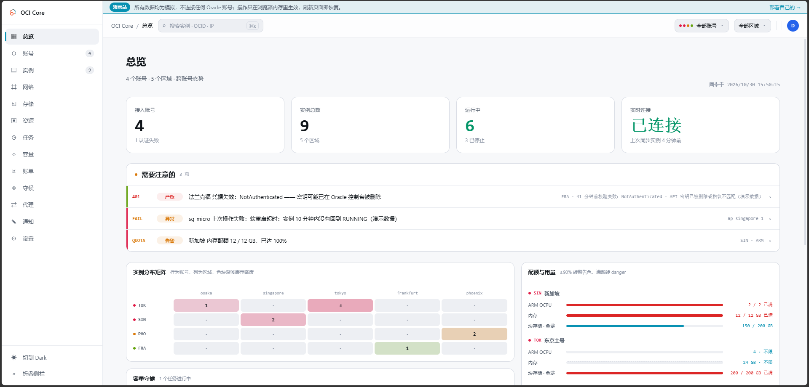

---

## 目录

- [这是什么](#这是什么)
- [功能](#功能)
- [界面](#界面)
- [技术栈](#技术栈)
- [下载预编译二进制](#下载预编译二进制)
- [Docker 部署](#docker-部署)
- [本地开发](#本地开发)
- [配置](#配置)
- [安全须知](#安全须知)
- [架构](#架构)
- [已知限制](#已知限制)
- [免责声明](#免责声明)
- [开源协议](#开源协议)

---

## 这是什么

一个单二进制的 Web 面板，用来管理多个 Oracle Cloud 账号下的云主机。

- **单文件部署** —— 前端产物用 `go:embed` 编进二进制，约 11 MB，静态链接，无运行时依赖
- **不依赖官方 SDK** —— HTTP Signature 自己实现，约 100 行，依赖树极轻
- **数据留在本地** —— SQLite + 文件系统，不向任何第三方上报

> **不在范围内**：发票与付款记录（Oracle 未开放接口）、多用户 RBAC。

> **关于开发方式**：本项目的代码主要由 AI 编程助手（Claude Code）编写，作者负责需求、审阅与测试。
> 使用前请按自己的标准评估代码与安全性，尤其是它会持有你的云账号凭据这一点。

---

## 功能

| 域 | 内容 |
|---|---|
| **账号管理** | 多租户 API 密钥接入、粘贴 config 自动解析、添加时即选定代理出口（测试连接也走代理）、连通性逐项校验、账号类型识别（试用号 / 升级号）、开户天数、配额查询、定期复查凭据、密钥加密托管与轮换 |
| **实例管理** | 跨账号聚合列表（带缓存，显示 IPv4 与 IPv6）、按列排序、自定义显示列与列顺序、开关机与重启、改配置（含突发 CPU）、改名、备注、创建向导（免费预设之外可选该可用域的全部规格）、批量操作、终止、按镜像系统推断 SSH 用户、SSE 实时状态推送 |
| **后台任务** | 创建实例、换公网 IP、改配置、终止、启用 IPv6、增删网卡、批量操作、同步、云盘修改都在后台执行，提交后可以继续做别的；任务页实时显示进度与每一步，失败原因保留可查，同一台实例上的操作按顺序执行 |
| **网络** | VCN / 子网 / 安全规则可视化编辑、自动建网、更换公网 IP（新旧 IP 留在列表与审计日志里）、启用 IPv6（创建时或为已有实例开启）、添加与分离附属网卡（可带公网 IPv4 / IPv6），按账号分组 |
| **存储** | 引导卷与块存储的扩容、VPU 调整、分离与挂载；扩容后按系统给出重扫磁盘与扩分区的命令；含**救援模式**（分离引导卷 → 挂到另一台机器改文件 → 挂回） |
| **资源盘点** | 按账号汇总各区域的卷、公网 IP（含保留 IP）、控制台连接与 VCN；对照 Oracle 限额与永久免费参考额度；单列未挂载的卷、未绑定的保留 IP、遗留的控制台连接与没有互联网网关的 VCN |
| **登录策略** | 读取并修改身份域的密码有效期。租户默认 120 天到期，管多个账号时每隔几月就要挨个重置；改完立即回读，显示服务端实际存下的值 |
| **代理** | 代理池：批量导入（认四种常见格式）、存活检测与延迟、逐账号绑定出口。一条代理只能绑一个账号——共用出口反而制造关联信号 |
| **账单** | 各账号本月与上月费用、日趋势、按服务、区域与计费项分解，单列出站流量，并按自然月对比每月 10 TB 免费出站额度；免费额度账号金额恒为零，转而展示实际用量（OCPU 小时 / GB 月） |
| **容量监控** | 调 Oracle 官方**只读**容量报告接口，盯住关心的规格什么时候有货，状态变化时推通知 |
| **容量守候** | 反复尝试创建实例直到成功。默认先查容量再尝试，没货就跳过本轮、不发创建请求 |
| **监控** | CPU / 内存 / 双向流量时间序列，粒度随跨度自适应；另有本月已用出入站流量（VCN 网卡统计，不依赖 Cloud Agent） |
| **控制台** | 串行控制台与 VNC 隧道连接串生成 |
| **通知** | Telegram / 企业微信 / 钉钉 / 邮件 / Webhook + 事件订阅矩阵 |
| **隐私** | 邮箱、公网 IP、OCID、指纹默认打码，每处带展开按钮，顶栏一键切换全局。复制永远给原文——为截图与录屏而做 |
| **安全** | argon2id 口令、TOTP 双因子（扫码绑定）、会话管理与强制下线、CSRF 防护、登录限流、审计日志（游标分页 + 全量导出 + 可选保留策略）、危险操作三级门槛 |

---

## 界面

截图均来自[在线演示](https://jsongmax.github.io/oci-core/)，数据为模拟。点击图片看原图，点标题展开其余分组；想看完整交互，直接去演示站点一点。

<details open>
<summary><b>实例</b> · 列表 · 创建 · 详情 · 后台任务</summary>
<br>

<table>
<tr><td width="50%" valign="top"><a href="docs/screenshots/instances.png">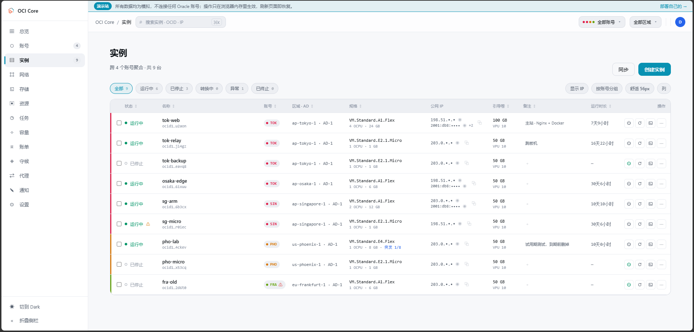</a><br><b>实例列表</b> · 跨账号聚合，色条与代号标出归属；列可显隐、可拖宽，公网 IP 一键显隐</td><td width="50%" valign="top"><a href="docs/screenshots/create-instance.png">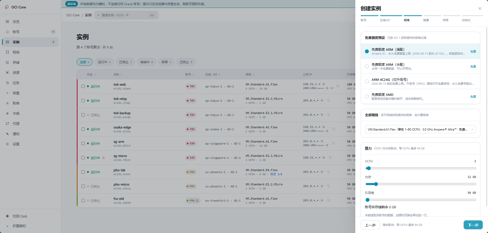</a><br><b>创建向导</b> · 免费预设之外可选该可用域的全部规格，镜像按架构过滤</td></tr>
<tr><td width="50%" valign="top"><a href="docs/screenshots/instance-network.png">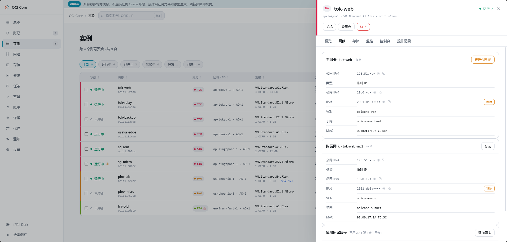</a><br><b>网络</b> · 主网卡与附属网卡并列；更换公网 IP、增删 IPv6、添加 / 分离附属网卡</td><td width="50%" valign="top"><a href="docs/screenshots/instance-storage.png">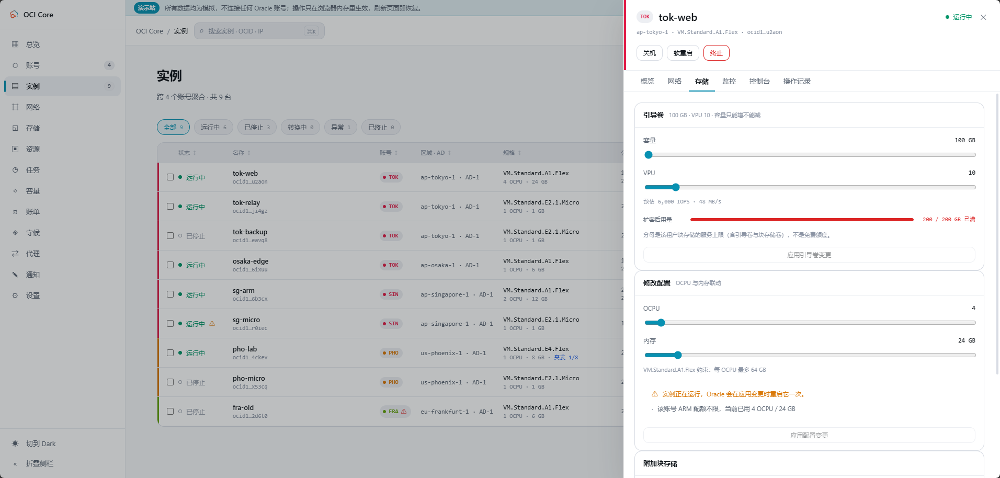</a><br><b>存储与配置</b> · 引导卷扩容与 VPU 用滑块调，改配置时 OCPU 与内存联动</td></tr>
<tr><td width="50%" valign="top"><a href="docs/screenshots/instance-rescue.png">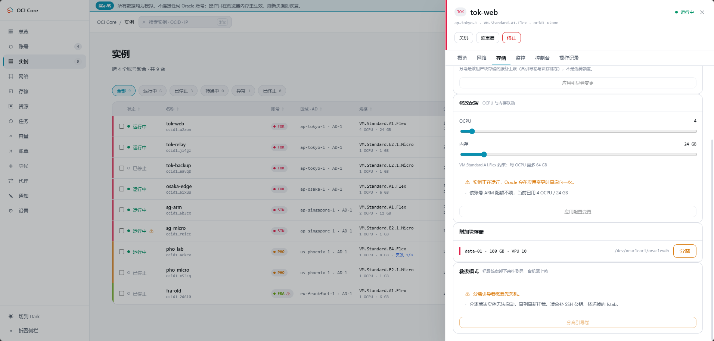</a><br><b>救援模式</b> · 把起不来的系统盘挂到另一台机器上改文件，再挂回去</td><td width="50%" valign="top"><a href="docs/screenshots/instance-metrics.png">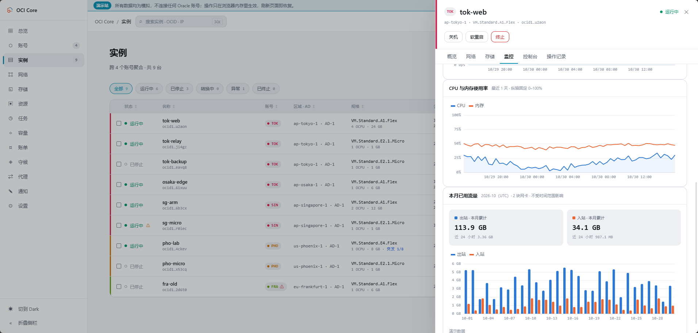</a><br><b>监控</b> · CPU / 内存曲线与本月出入站流量，粒度随跨度自适应</td></tr>
<tr><td width="50%" valign="top"><a href="docs/screenshots/instance-console.png">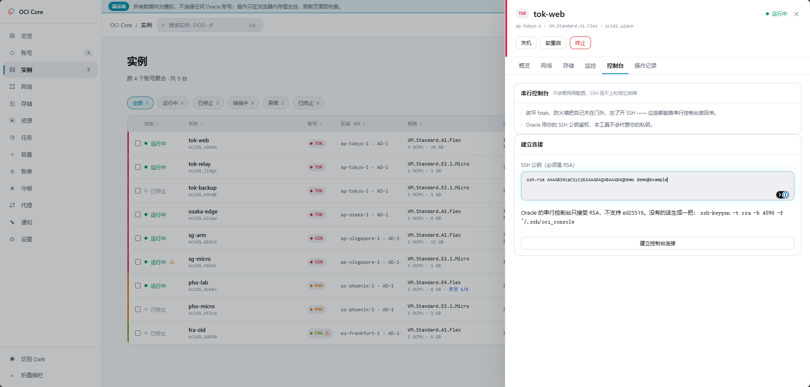</a><br><b>串行控制台</b> · SSH 连不上时排障；只接受 RSA 公钥，不代管私钥</td><td width="50%" valign="top"><a href="docs/screenshots/jobs.png">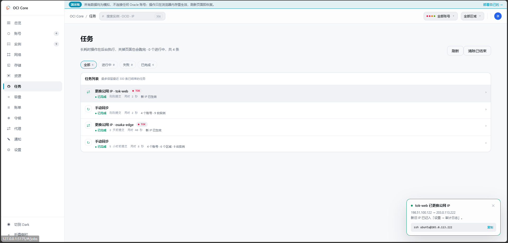</a><br><b>后台任务</b> · 创建、换 IP、改配置等长耗时操作在后台跑，关掉页面也会跑完</td></tr>
</table>

</details>

<details>
<summary><b>账号与资源</b> · 账号 · 资源盘点 · 网络 · 账单</summary>
<br>

<table>
<tr><td width="50%" valign="top"><a href="docs/screenshots/accounts.png">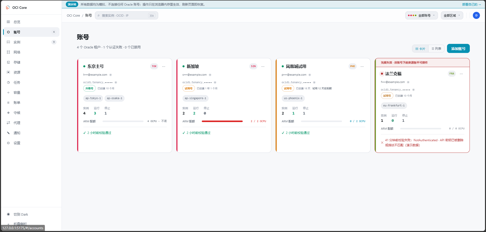</a><br><b>账号</b> · 连通性、试用倒计时、开户天数与 ARM 配额一屏看全</td><td width="50%" valign="top"><a href="docs/screenshots/resources.png">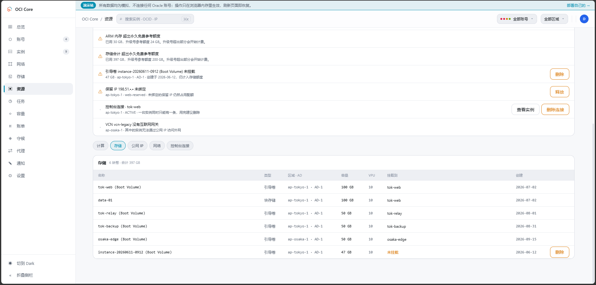</a><br><b>资源盘点</b> · 按账号对照免费额度，单列未挂载的卷、未绑定的保留 IP 并可直接清理</td></tr>
<tr><td width="50%" valign="top"><a href="docs/screenshots/network.png">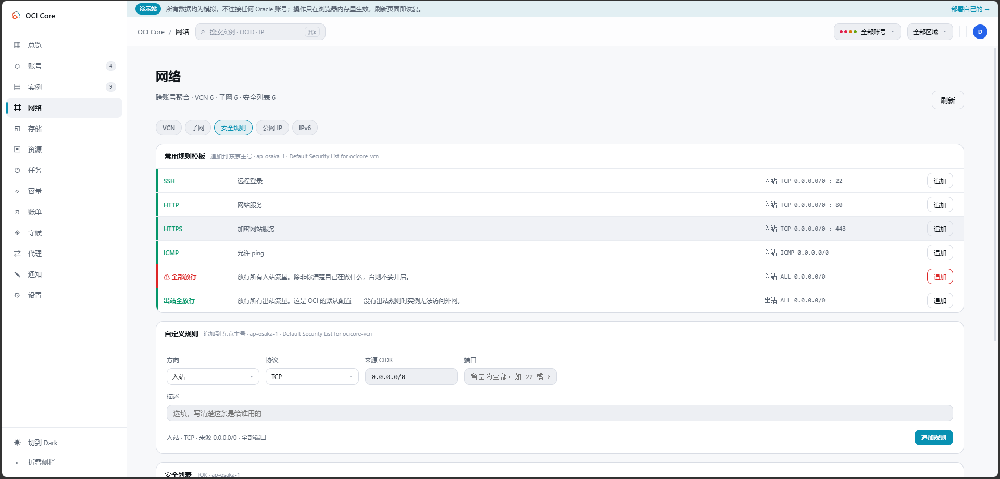</a><br><b>安全规则</b> · 常用规则一键追加，「全部放行」单独警示</td><td width="50%" valign="top"><a href="docs/screenshots/billing.png">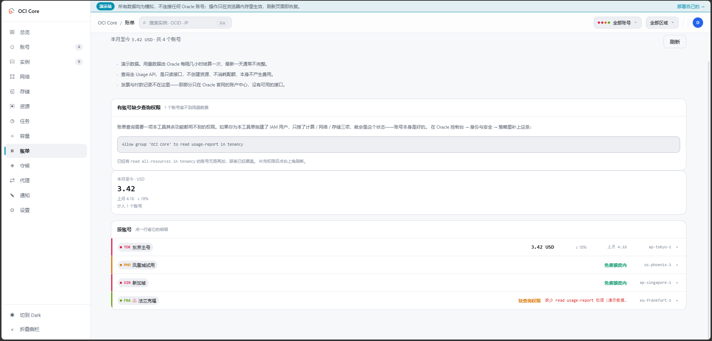</a><br><b>账单</b> · 本月与上月费用、按服务与计费项分解；免费号改看用量</td></tr>
</table>

</details>

<details>
<summary><b>容量与守候</b> · 容量监控 · 容量守候</summary>
<br>

<table>
<tr><td width="50%" valign="top"><a href="docs/screenshots/capacity.png">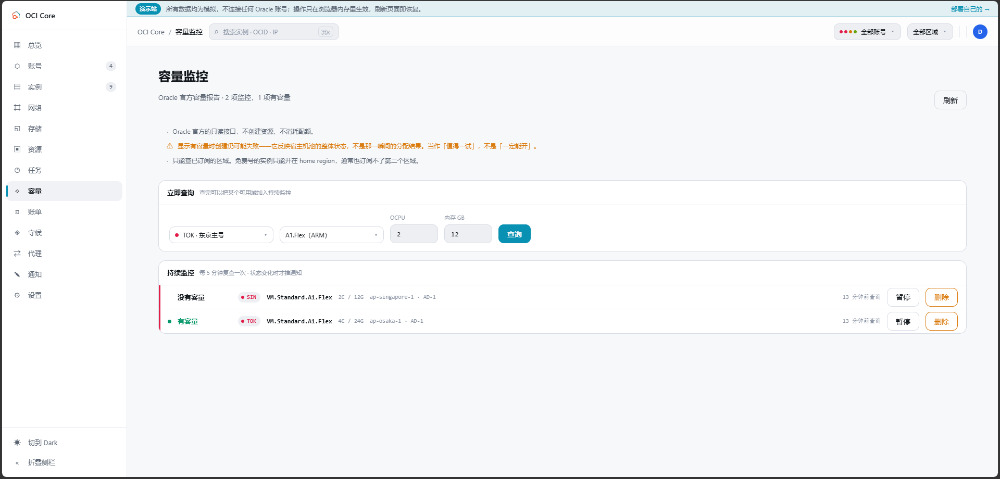</a><br><b>容量监控</b> · 调 Oracle 只读的容量报告，看某规格在各可用域有没有货</td><td width="50%" valign="top"><a href="docs/screenshots/hunt.png">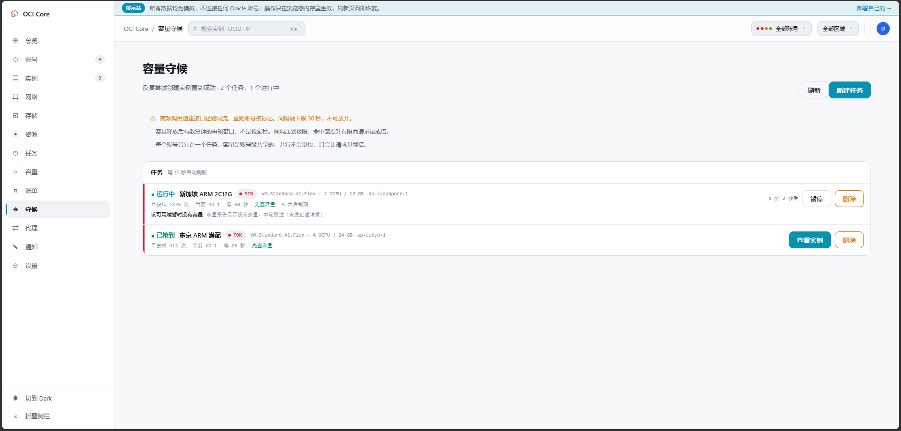</a><br><b>容量守候</b> · 反复尝试创建直到成功，默认先查容量，没货就不发创建请求</td></tr>
</table>

</details>

<details>
<summary><b>设置</b> · 操作策略 · 两步验证 · 审计</summary>
<br>

<table>
<tr><td width="50%" valign="top"><a href="docs/screenshots/settings.png">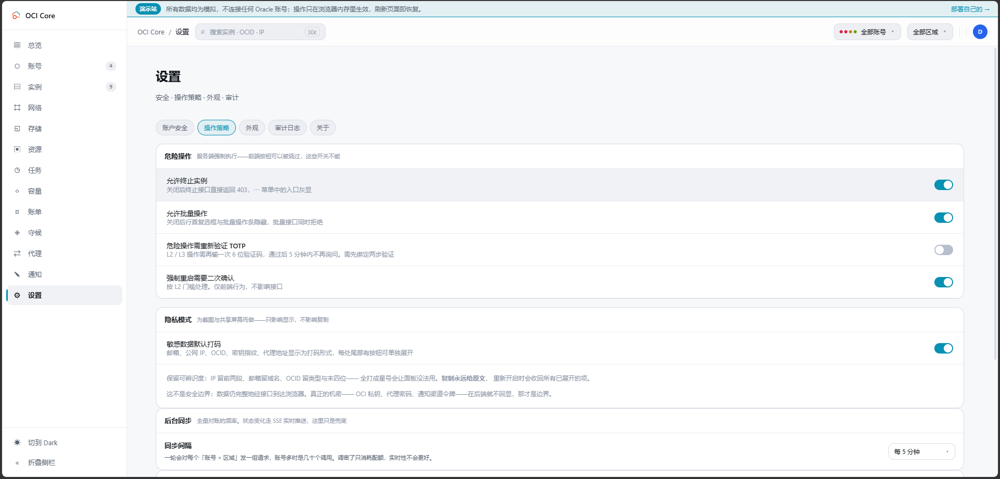</a><br><b>设置</b> · 危险操作策略、两步验证、审计日志与保留期限</td><td width="50%"></td></tr>
</table>

</details>

---

## 技术栈

| 层 | 选型 | 说明 |
|---|---|---|
| 后端 | **Go 1.26** | 标准库 `net/http`，无 Web 框架 |
| 数据库 | **SQLite**（`modernc.org/sqlite`） | 纯 Go 实现，免 CGO，可静态编译 |
| OCI 接入 | **自实现 HTTP Signature** | draft-cavage，RSA-SHA256，不用官方 SDK |
| 加密 | **AES-256-GCM** 信封加密 · **argon2id** · **RFC 6238 TOTP** | 私钥落库加密，AAD 绑定账号 ID |
| 前端 | **Vue 3 + TypeScript + Vite** | 组合式 API，无 UI 框架，样式手写；二维码编码用零依赖的 `qrcode-generator` |
| 实时 | **SSE** | 状态变化服务端推送 |
| 容器 | **Docker**（三阶段构建） | node → golang → alpine |

---

## 下载预编译二进制

不想自己编译就去 [Releases](https://github.com/jsongmax/oci-core/releases) 拿。
每个 tag 由 GitHub Actions 自动构建五个平台，附 `checksums.txt`：

| 平台 | 文件 |
|---|---|
| Linux x86_64 | `ocicore_<版本>_linux_amd64.tar.gz` |
| **Linux ARM64** | `ocicore_<版本>_linux_arm64.tar.gz` |
| macOS Apple Silicon | `ocicore_<版本>_darwin_arm64.tar.gz` |
| macOS Intel | `ocicore_<版本>_darwin_amd64.tar.gz` |
| Windows x86_64 | `ocicore_<版本>_windows_amd64.zip` |

> 甲骨文免费额度给的是 ARM（Ampere A1）。想把面板自托管在自己那台免费机器上，
> 要的是 **linux_arm64** 那个。

解开直接跑，无运行时依赖：

```bash
tar xzf ocicore_0.2.1_linux_arm64.tar.gz && ./ocicore
```

---

## Docker 部署

**推荐方式。** 需要 Docker 与 Docker Compose。

### 拉现成镜像（快）

CI 已经构建好多架构镜像推到了 GHCR，服务器上不需要 Node 和 Go：

```bash
git clone https://github.com/jsongmax/oci-core.git
cd oci-core
docker compose pull && docker compose up -d
```

镜像同时提供 `linux/amd64` 与 `linux/arm64`，Docker 会自动挑对应架构——
甲骨文那台免费 ARM 机器上照样是这条命令。

| 标签 | 指向 |
|---|---|
| `latest` | 最新发布版本 |
| `0.2.3` | 具体版本 |
| `0.2` | 该次版本线的最新补丁 |
| `edge` | main 的最新提交，未发版 |

### 自己构建

改了代码想立刻验证，或者不想依赖 GHCR：

```bash
docker compose up -d --build
```

`docker-compose.yml` 里 `image` 与 `build` 都保留着，两条路都能走。

浏览器打开 `http://127.0.0.1:8080`，按引导完成首次设置与两步验证绑定。

镜像分三阶段构建：前端（Vite）→ 后端（静态编译）→ alpine 运行时。
运行时镜像里只有一个可执行文件加一个数据目录。

### 三件容易出错的事

<details>
<summary><b>1. 端口不要直接映射成 <code>8080:8080</code></b></summary>

<br>

`docker-compose.yml` 里写的是 `127.0.0.1:8080:8080`，**只绑宿主机回环**。
这个面板持有你所有甲骨文租户的完整控制权，直接挂到公网 8080 等于把登录页
交给全世界去撞。远程访问用其中之一：

```bash
# SSH 隧道，最省事
ssh -L 8080:127.0.0.1:8080 你的服务器
```

或前面放一个带 TLS 的反向代理（Nginx / Caddy / Cloudflare Tunnel），
**此时才需要**设 `OCICORE_TRUST_PROXY=true`。没有代理却开着，任何人都能靠
伪造 `X-Forwarded-For` 绕过登录失败限流。

</details>

<details>
<summary><b>2. 容器内必须绑 <code>0.0.0.0</code></b></summary>

<br>

程序默认监听 `127.0.0.1`，那在容器里等于谁也连不上。镜像已经把
`OCICORE_ADDR=0.0.0.0:8080` 写进 `ENV`，自己写 `docker run` 时别漏掉。

这不等于暴露到公网——对外与否由 `-p` 决定。

</details>

<details>
<summary><b>3. <code>ocicore_ocicore-data</code> 卷丢了，所有账号私钥就都解不开了</b></summary>

<br>

卷里是 `master.key` 与加密后的数据库，**两者缺一不可**：

- 只有数据库 → 私钥全是密文，解不开
- 只有密钥 → 没有数据

更要命的是，`master.key` 缺失时程序**不会报错**：它会生成一把全新的随机密钥，
服务照常启动、你照常能登录、账号列表还在，但每个账号一用就失败，而且是永久解不开。

备份整个数据目录：

```bash
# 卷名带 compose 项目名前缀。先确认实际叫什么：
docker volume ls | grep ocicore

docker run --rm -v ocicore_ocicore-data:/data -v "$PWD:/backup" \
  alpine tar czf /backup/ocicore-backup.tar.gz -C /data .
```

还原时反向解到同一个卷即可。**备份文件本身等同于私钥，请当作密钥保管。**

</details>

### 升级

```bash
docker compose up -d --build
```

数据在命名卷里，重建容器不会动它。数据库迁移在启动时自动执行。

> **绝对不要加 `-v`**（`docker compose down -v`）—— 那会删掉命名卷 `ocicore_ocicore-data`，
> 连同 `master.key` 和全部加密私钥一起消失。

---

## 本地开发

需要 **Go 1.26+** 与 **Node 18+**（CI 镜像用的是 Node 24）。

### 直接跑

```bash
go run ./cmd/server
```

默认监听 `127.0.0.1:8080`，数据写入 `./data/`，首次启动自动生成主密钥。

### 前端开发

```bash
cd web && npm install && npm run dev
```

开发服务器在 `5173`，`/api` 自动代理到 `127.0.0.1:8080`。

也可以让后端直接读磁盘上的产物，改前端不用重编 Go：

```bash
OCICORE_STATIC_DIR=./internal/web/dist go run ./cmd/server
```

### 演示站

[在线演示](https://jsongmax.github.io/oci-core/)是前端的一个特殊构建：不需要后端，所有接口由
`web/src/demo/server.ts` 在浏览器里模拟，数据全是编的（IP 用文档保留段）。
每次打 `v*` tag 时由 `.github/workflows/pages.yml` 构建并部署到 GitHub Pages。

```bash
cd web && npm run build:demo   # 产物在 web/dist-demo
```

正常构建（`npm run build`）会把演示代码整个摇掉，发版的二进制与镜像里没有它。
新增接口时记得在 `server.ts` 里补一个模拟实现，否则演示站上会提示「不支持」。

### 构建单二进制

前端产物已提交进仓库，直接构建即可：

```bash
go build -ldflags "-s -w -X main.version=0.1.0" -o dist/ocicore ./cmd/server
```

改了前端才需要重新构建它：

```bash
cd web && npm run build
```

Vite 的输出目录指向 `internal/web/dist`，被 `go:embed` 打进二进制。
**因为是编译期解析，那个目录不存在的话 Go 会直接编译失败。**

### 测试

```bash
go test ./... && go vet ./...
cd web && npm run typecheck
```

推送后 GitHub Actions 会跑同样的检查，外加 `gofmt` 与一次前端试构建。

### 提交信息

用 [Conventional Commits](https://www.conventionalcommits.org/)：类型前缀用英文，
描述用中文。

```
feat(billing): 接入 OCI Usage API
fix(billing): 补服务名翻译与截断
ci: 多架构镜像推送到 GHCR
```

主题行只说**做了什么**，不带解释性从句——GitHub Actions 拿它当运行标题，
拖着「，服务器不必再本地构建」这种后半句会很难读。原因、权衡、踩过的坑
写进正文，正文可以尽情写长。

> 若你的 `go env` 把 `GOOS` 设成了 `linux`（便于直接产出部署二进制），
> 在 Windows 上跑测试需临时覆盖目标平台：
>
> ```bash
> GOOS=windows GOARCH=amd64 go test ./...
> ```

---

## 配置

全部通过环境变量。

| 变量 | 默认值 | 说明 |
|---|---|---|
| `OCICORE_ADDR` | `127.0.0.1:8080` | 监听地址。**容器内必须设成 `0.0.0.0:8080`** |
| `OCICORE_DATA_DIR` | `./data` | 数据库与主密钥目录 |
| `OCICORE_MASTER_KEY` | 空 | 十六进制主密钥，留空则用 `$DATA_DIR/master.key` |
| `OCICORE_STATIC_DIR` | 空 | 前端产物目录，非空时优先于嵌入资源（开发用） |
| `OCICORE_SESSION_TTL` | `12h` | 会话有效期，滑动续期 |
| `OCICORE_TRUST_PROXY` | `false` | 是否采信 `X-Forwarded-*`。**仅在确实位于反向代理之后才可开启** |
| `OCICORE_NOTIFY_ALLOWED_NETS` | 空 | 通知 webhook 额外放行的网段，逗号分隔（如 `10.0.0.0/8,192.168.1.5`）。默认禁止访问回环、内网与链路本地地址。通知请求不经过 `HTTP_PROXY`／`HTTPS_PROXY` 等环境代理（经代理时目标由代理解析，面板无法限制） |

面板内还可配置：后台同步间隔、凭据复查间隔、审计日志保留期限、危险操作策略。

---

## 安全须知

这个面板持有你**所有** Oracle 租户的完整控制权。

1. **为本工具创建专用 IAM 用户**，只授予 compute / vcn / block-storage 的必要策略，不要用 Administrators 组的密钥。**这一条比其余所有加固加起来都管用。** 账号详情的「权限自检」页有可直接照抄的策略示例。账单页额外需要 `read usage-report in tenancy`——**不想让它读账单就别加这条**，其余功能不受影响。容量监控与守候的容量预检需要 `manage compute-capacity-reports in tenancy`，它不含在 `instance-family` 里。组名带空格时要加引号，例如 `Allow group 'OCI Core' to …`。
2. **默认只监听回环。** 远程访问请置于 TLS 反向代理之后。
3. **备份 `master.key`。** 它是所有已存 OCI 私钥的唯一解密钥匙，丢失后账号需全部重新录入；同时它绝不能进版本库（`.gitignore` 已覆盖）。
4. **启用两步验证。** 首次设置后会直接引导绑定，用验证器扫码即可。
5. **给每个账号配好代理再添加。** 添加账号时选好网络出口，测试连接与之后的请求都会走它；先直连测试、事后再绑代理，抹不掉第一次的访问记录。
6. 私钥以 AES-256-GCM 加密落库，AAD 绑定账号 ID；**界面上没有任何导出或回显私钥的入口**。
7. **部署后立刻完成首次设置。** `GET /api/status` 是公开端点（登录页要靠它判断是否需要初始化），会返回 `setupRequired`。一台已上线但还没设置管理员的面板，扫描器发现后可以直接抢注。
8. **反向代理后才开 `OCICORE_TRUST_PROXY`。** 代理必须自己覆写该头（Nginx 用 `proxy_set_header X-Forwarded-For $proxy_add_x_forwarded_for;`）。
9. 前端不加载任何外部资源（无 CDN、无 Google Fonts）。CSP 为 `default-src 'self'`，既是防护，也意味着面板在完全离线的内网里同样能用。

---

## 架构

```
cmd/server          入口：配置、建连、路由、优雅退出
internal/
  ociclient         OCI API 客户端：签名器、错误分类、Compute / 网络 / 存储 / 限额 / 监控 / 容量 / 控制台
  ociconn           按账号构建客户端（私钥解密的唯一去处）
  cryptobox         私钥信封加密
  store             SQLite：账号 / 用户 / 会话 / 实例缓存 / 设置 / 通知渠道 / 审计 / 守候任务 / 容量监控
  auth              argon2id · TOTP · 会话令牌
  accountsvc        连通性逐项校验
  instancesvc       跨账号聚合、生命周期编排、SSE 事件总线
  netsvc            自动建网、换 IP、启用 IPv6、安全规则模板
  huntsvc           容量守候调度器：退避、可用域轮换、防重复创建
  capacitysvc       容量监控轮询
  billingsvc        用量与成本聚合（Usage API）
  proxypool         代理解析、存活检测、绑定约束
  notify            通知渠道分发
  httpapi           REST 接口层
  web               前端产物 embed
web/                前端源码（Vue 3 + TS + Vite）
docs/
  API.md                接口参考
  FRONTEND-DESIGN.md    前端设计规格书
  CAPACITY-HUNTER.md    容量守候设计文档
```

<details>
<summary><b>几处刻意的取舍</b></summary>

<br>

- **自实现签名而非官方 SDK** —— OCI 用的是 draft-cavage HTTP Signatures，约 100 行即可实现。换来极轻的依赖树和完全可控的错误分类。[`internal/ociclient/errors.go`](internal/ociclient/errors.go) 是全项目最重要的一张表：它决定了什么该重试、等多久、什么时候该把账号标成异常。

- **实例列表走缓存** —— 8 个账号 × 4 个区域就是 32 次 API 往返。后台定期同步写入 SQLite，列表读缓存秒开，状态变化用 SSE 推送。同步错误按（账号 × 区域）隔离，一个账号失效不会让整张列表变空。

- **乐观更新只到过渡态** —— 接口返回的一定是 `STOPPING` 而非 `STOPPED`，落定由后台轮询确认后经 SSE 推送。既不让用户以为没反应，也不骗他说已经好了。

- **危险操作在服务端校验** —— 终止实例要回传实例名，删除账号要回传别名，`allowTerminate` 关掉就直接 403。前端的确认框是体验，这些才是防线。

- **SQLite 而非 Postgres** —— 单机单进程、几十个账号。纯 Go 实现，免 CGO，交叉编译无痛。

- **自定义请求头做 CSRF 防护** —— 浏览器不允许跨源请求携带自定义头（本服务从不开启 CORS），因此「存在 `X-OCI-Tools` 头」即等价于「请求来自本站脚本」。比双提交 Cookie 简单，且没有令牌同步问题。

- **容量守候默认先查容量** —— 容量报告是只读接口，`LaunchInstance` 才是 Oracle 风控盯的那个。用一次只读换掉一次创建，能把真正发出去的创建请求降一个数量级。

- **账号身份色 + 短代号** —— 多账号管理的核心认知负担是「这台机器是哪个号的」。代号是必填项而非装饰：可访问性要求颜色不能单独承载信息。

</details>

---

## 已知限制

- 监控数据依赖实例内运行的 Oracle Cloud Agent，未安装时接口正常返回但序列为空。
- 容量报告显示「有容量」时创建**仍可能失败**——它反映的是宿主机池的整体状态，不是那一瞬间的分配结果。
- 容量监控只能查**已订阅的区域**。永久免费账号的实例只能开在 home region，通常也订阅不了第二个区域。
- 账单数据由 Oracle 每隔几小时结算一次，最新一天通常不完整，**给不出「实时消费」**。
- 账单需要额外的 `read usage-report` 权限。缺这项时页面显示「缺查询权限」并给出可照抄的策略——那不是账号故障。
- **发票与付款记录查不到。** 那部分只在 Oracle 官网的账户中心，走的不是 OCI 的签名体系，没有可用的接口。
- 引导卷扩容后，扩分区仍要自己登录实例执行面板给出的命令；还没有接 Oracle 的 Run Command 自动执行。
- 出站流量按计费项名称（Outbound Data Transfer …）归总，单位照 Oracle 返回的显示，不做换算。
- 存储卷的自动性能调整、实例配置与实例池未实现。
- 备份与快照策略未实现。

---

## 免责声明

**使用本软件前请阅读。**

1. **本项目与 Oracle 公司无任何关联**，未获得 Oracle 的认可、赞助或背书。
   Oracle、Oracle Cloud、OCI 是 Oracle 公司的商标。

2. **你必须自行确保使用方式符合 Oracle 的服务条款。**
   本软件只是把官方 API 包装成一个更好用的界面，但**你**要为通过它发出的每一个
   请求负责。特别是「容量守候」功能：它会持续调用创建实例接口，
   **高频调用是 Oracle 明确不欢迎的行为**，可能导致请求被限流、账号被标记，
   极端情况下账号被停用。软件内置了退避、频率下限与风险提示，
   但**最终风险由使用者承担**。

3. **本软件持有你的云账号凭据。** 请务必按[安全须知](#安全须知)部署，
   尤其是不要把面板直接暴露到公网、以及为其创建权限最小化的专用 IAM 用户。

4. **不对数据丢失负责。** 丢失 `master.key` 会导致所有已存 OCI 私钥永久无法解密。
   终止实例、删除引导卷等操作**不可撤销**。请自行做好备份。

5. **代码主要由 AI 编写。** 本项目的代码主要由 AI 编程助手（Claude Code）编写，
   作者负责需求、审阅与测试。AI 写的代码可能含有审阅时没发现的错误，
   请在接入重要账号前自行评估。

6. 本软件按「原样」提供，不提供任何形式的担保。详见 [LICENSE](LICENSE)。

---

## 开源协议

[MIT](LICENSE) © 2026 jsongmax
